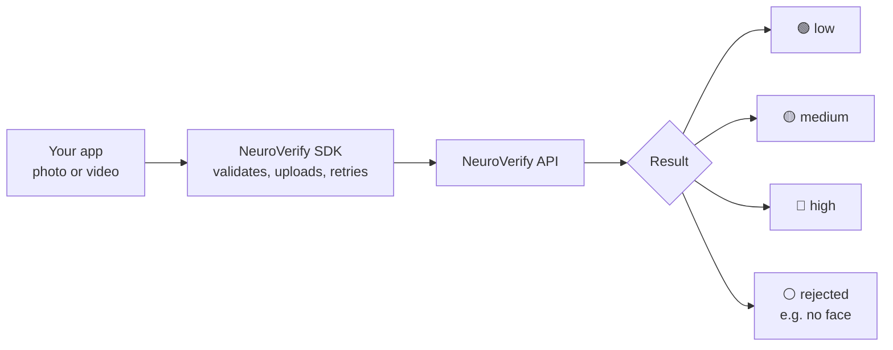

<div align="center">

# NeuroVerify SDKs

**Official Neural Defend clients for detecting deepfakes, AI-generated faces, and spoofed media.**

Send a photo or video, get back a clear `low` / `medium` / `high` risk answer in a few lines of code.

[](https://github.com/Neural-Defend/NeuralDefend-SDKs/actions/workflows/test.yml)
[](LICENSE)
[](https://neuraldefend.gitbook.io/neural-defend)
[](https://neuraldefend.com/)

[Choose an SDK](#choose-an-sdk) · [Get an API key](#get-an-api-key) · [Quick start](#quick-start) · [Understanding results](#understanding-results) · [Documentation](#documentation) · [Support](#support)

</div>

---

## What is NeuroVerify?

**NeuroVerify** is Neural Defend's media-authenticity API. It looks at a face photo or a
video and tells you how likely it is that the media was **faked**: printed or replayed in
front of a camera (spoofing), generated by AI, face-swapped, or given a cloned voice.

These SDKs wrap the API so you never have to build HTTP requests, multipart uploads,
retries, or response parsing yourself. Every SDK works the same way:



1. **Create a client** with your API key.
2. **Call `detectImage`** for a photo or **`detectVideo`** for a video.
3. **Read the risk level** and decide what your app should do.

## Choose an SDK

| Language | Package | Version | Install | Guide |
|---|---|---|---|---|
| **Python** | `neuraldefend` | [](https://pypi.org/project/neuraldefend/) | `pip install neuraldefend` | [Python guide](packages/python/README.md) |
| **TypeScript / JavaScript** | `@neuraldefend/sdk` | [](https://www.npmjs.com/package/@neuraldefend/sdk) | `npm install @neuraldefend/sdk` | [TypeScript guide](packages/typescript/README.md) |
| **Go** | `packages/go` | [](https://github.com/Neural-Defend/NeuralDefend-SDKs/tree/main/packages/go) | `go get github.com/Neural-Defend/NeuralDefend-SDKs/packages/go@v1.0.0` | [Go guide](packages/go/README.md) |
| **Java** | `com.neuraldefend:neuraldefend-sdk` | [](https://github.com/Neural-Defend/NeuralDefend-SDKs/tree/main/packages/java) | `implementation("com.neuraldefend:neuraldefend-sdk:1.0.0")` | [Java guide](packages/java/README.md) |
| **Kotlin / Android** | `com.neuraldefend:neuraldefend-kotlin` | [](https://central.sonatype.com/artifact/com.neuraldefend/neuraldefend-kotlin) | `implementation("com.neuraldefend:neuraldefend-kotlin:1.0.0")` | [Kotlin guide](packages/kotlin/README.md) |
| **Dart / Flutter** | `neuraldefend` | [](https://pub.dev/packages/neuraldefend) | `flutter pub add neuraldefend` | [Dart and Flutter guide](packages/dart/README.md) |
| **Swift** | `NeuralDefend` | [](https://github.com/Neural-Defend/NeuralDefend-SDKs/tree/main/packages/swift) | Swift Package Manager | [Swift guide](packages/swift/README.md) |
| **MCP server** | `neuraldefend-mcp` | [](https://pypi.org/project/neuraldefend-mcp/) | `pip install neuraldefend-mcp` | [MCP guide](packages/mcp/README.md) |

**Which one should I use?**

- Building a **backend service, script, or CLI**? Use the SDK for your server language:
  Python, TypeScript (Node.js), Go, Java, or Kotlin.
- Building a **mobile or desktop app**? Use Kotlin (Android), Swift (iOS and macOS), or
  Dart (Flutter), and keep production keys on your backend (see
  [Keep your key safe](#keep-your-key-safe)).
- Building a **website**? Use the TypeScript SDK in the browser with a short-lived key
  from your backend.
- Want an **AI assistant** (Claude, Cursor, VS Code) to check files for you? Use the
  MCP server.

| SDK | Runtime requirements |
|---|---|
| Python | Python 3.9+ |
| TypeScript | Node.js 22+ or an evergreen browser |
| Go | Go 1.22+ |
| Java | Java 17+ |
| Kotlin / Android | Kotlin on the JVM (Java 8+), Android API 21+ |
| Dart / Flutter | Dart 3.5+; Android, iOS, web, and desktop |
| Swift | Swift 6.0+; iOS, iPadOS, macOS, Mac Catalyst, visionOS, and Linux |
| MCP server | Python 3.10+ and an MCP-compatible client |

## Get an API key

NeuroVerify API keys are issued by **Neural Defend** after customer onboarding.

1. Visit **[neuraldefend.com](https://neuraldefend.com/)** and choose **Book a Demo**.
2. After onboarding, you receive a key for the image and/or video endpoint. Ask for a
   **staging key** as well if you want a safe place to test.
3. Store the key in the `NEURALDEFEND_API_KEY` environment variable. Server SDKs read it
   automatically.

macOS / Linux:

```bash
export NEURALDEFEND_API_KEY="replace-with-your-api-key"
```

Windows PowerShell:

```powershell
$env:NEURALDEFEND_API_KEY = "replace-with-your-api-key"
```

Existing customers can contact [support@neuraldefend.com](mailto:support@neuraldefend.com)
for new keys, staging access, or endpoint scope questions.

### Keep your key safe

- Never commit a key to source control or paste it into logs or tickets.
- Never put a long-lived production key inside a browser, Android, iOS, or Flutter app.
  Anyone can extract it. Call NeuroVerify from your backend, or have your backend hand
  the app a short-lived credential.

## Quick start

Every example below checks one photo and one video. The output blocks are representative;
your scores and transaction IDs will differ.

### Python

```bash
pip install neuraldefend
```

```python
from neuraldefend import NeuroVerifyClient

with NeuroVerifyClient() as client:                  # reads NEURALDEFEND_API_KEY
    image = client.detect_image("selfie.jpg")
    video = client.detect_video("clip.mp4")

print("image:", image.risk_level, image.risk_score)
print("video:", video.video_risk_level, "| audio:", video.audio_risk_level)
```

```text
image: low 2.2
video: low | audio: high
```

[Full Python guide with 10 examples →](packages/python/README.md)

### TypeScript and Node.js

```bash
npm install @neuraldefend/sdk
```

```ts
import { NeuroVerifyClient } from "@neuraldefend/sdk";

const client = new NeuroVerifyClient();              // reads NEURALDEFEND_API_KEY
const image = await client.detectImage("selfie.jpg");
const video = await client.detectVideo("clip.mp4");

console.log(image.status, video.status);
```

```text
success success
```

[Full TypeScript guide →](packages/typescript/README.md)

### Browser

The same `@neuraldefend/sdk` package works in the browser; your bundler picks the browser
build automatically. Pass a short-lived credential from your backend, never a production key.

```ts
import { NeuroVerifyClient } from "@neuraldefend/sdk";

const client = new NeuroVerifyClient({ apiKey: shortLivedKeyFromYourBackend });
const input = document.querySelector<HTMLInputElement>("#photo")!;
const image = await client.detectImage(input.files![0]);
```

### Go

```bash
go get github.com/Neural-Defend/NeuralDefend-SDKs/packages/go@v1.0.0
```

```go
client, err := neuraldefend.NewClient(neuraldefend.ClientOptions{
    APIKey: os.Getenv("NEURALDEFEND_API_KEY"),
})
if err != nil {
    log.Fatal(err)
}

ctx := context.Background()
image, err := client.DetectImage(ctx, neuraldefend.FileMedia("selfie.jpg"))
if err != nil {
    log.Fatal(err)
}
video, err := client.DetectVideo(ctx, neuraldefend.FileMedia("clip.mp4"), neuraldefend.VideoOptions{})
if err != nil {
    log.Fatal(err)
}
fmt.Println(image.Status, video.Status)
```

```text
success success
```

[Full Go guide →](packages/go/README.md)

### Java

```kotlin
// build.gradle.kts
implementation("com.neuraldefend:neuraldefend-sdk:1.0.0")
```

```java
import com.neuraldefend.ClientOptions;
import com.neuraldefend.ImageResult;
import com.neuraldefend.Media;
import com.neuraldefend.NeuroVerifyClient;
import com.neuraldefend.VideoOptions;
import com.neuraldefend.VideoResult;

NeuroVerifyClient client = NeuroVerifyClient.newClient(new ClientOptions()); // reads NEURALDEFEND_API_KEY
ImageResult image = client.detectImage(Media.fileMedia("selfie.jpg"));
VideoResult video = client.detectVideo(Media.fileMedia("clip.mp4"), new VideoOptions());

System.out.println("image: " + image.riskLevel + " " + image.riskScore);
```

```text
image: low 2.2
```

[Full Java guide →](packages/java/README.md)

### Kotlin and Android

```kotlin
// build.gradle.kts
implementation("com.neuraldefend:neuraldefend-kotlin:1.0.0")
implementation("com.neuraldefend:neuraldefend-android:1.0.0") // Android content Uris
```

```kotlin
import com.neuraldefend.kotlin.MediaInput
import com.neuraldefend.kotlin.NeuroVerifyClient
import java.io.File
import kotlinx.coroutines.runBlocking

// detectImage and detectVideo are suspend functions; call them from a coroutine.
// JVM servers read NEURALDEFEND_API_KEY; Android apps must pass apiKey.
fun main() = runBlocking {
    NeuroVerifyClient().use { client ->
        val image = client.detectImage(MediaInput.file(File("selfie.jpg")))
        val video = client.detectVideo(MediaInput.file(File("clip.mp4")))
        println("${image.status} ${video.status}")
    }
}
```

```text
SUCCESS SUCCESS
```

On Android, upload photo-picker results with `MediaInputs.fromUri(context, uri)`.
[Full Kotlin and Android guide →](packages/kotlin/README.md)

### Dart and Flutter

```bash
flutter pub add neuraldefend   # or: dart pub add neuraldefend
```

```dart
import 'package:neuraldefend/neuraldefend.dart';

// Dart servers read NEURALDEFEND_API_KEY; Flutter and web apps must pass apiKey.
final client = NeuroVerifyClient();
final image = await client.detectImage(MediaInput.file('selfie.jpg'));
final video = await client.detectVideo(MediaInput.file('clip.mp4'));
print('${image.status.name} ${video.status.name}');
client.close();
```

```text
success success
```

In Flutter apps, call NeuroVerify from your backend rather than shipping a production key
([why](packages/dart/README.md#flutter-and-web-credential-safety)).
[Full Dart and Flutter guide →](packages/dart/README.md)

### Swift

```swift
// Package.swift
.package(url: "https://github.com/Neural-Defend/NeuralDefend-SDKs", from: "1.0.0")
```

```swift
import NeuralDefend

let client = try NeuroVerifyClient(apiKey: apiKey)
let image = try await client.detectImage(.file(photoURL))
let video = try await client.detectVideo(.file(clipURL))
print(image.status, video.status)
```

```text
success success
```

In iOS and macOS apps, call NeuroVerify from your backend rather than shipping a production
key ([why](packages/swift/README.md#get-an-api-key)).
[Full Swift guide →](packages/swift/README.md)

### MCP server for AI assistants

```bash
pip install neuraldefend-mcp
```

Add the server to your MCP client (for example Claude Desktop) and allow only the folders
it may read:

```json
{
  "mcpServers": {
    "neuraldefend": {
      "command": "neuraldefend-mcp",
      "env": {
        "NEURALDEFEND_API_KEY": "${NEURALDEFEND_API_KEY}",
        "NEURALDEFEND_MCP_ALLOWED_DIRS": "/absolute/path/to/authorized-media"
      }
    }
  }
}
```

Then ask your assistant: *"Check `selfie.jpg` in my media folder for signs of a deepfake."*
The server exposes the `detect_image_authenticity` and `detect_video_authenticity` tools.
[Full MCP guide →](packages/mcp/README.md)

## Understanding results

Every SDK returns the same information, named in that language's style
(`risk_level` in Python, `riskLevel` in TypeScript, `RiskLevel` in Go, and so on).

### The risk level is a traffic light

| Risk level | Meaning | Recommended action |
|---|---|---|
| 🟢 `low` | Few signs of manipulation were found | Continue with your normal process |
| 🟡 `medium` | The result is inconclusive | Ask for more evidence or a human review |
| 🔴 `high` | Strong signs of spoofing or AI generation | Escalate to a human reviewer |

Branch on the risk **level**, not on your own numeric threshold; the service may tune its
scoring bands over time.

### Photos and videos

| | Photo (`detectImage`) | Video (`detectVideo`) |
|---|---|---|
| Answers | One face risk score and level | A video risk **and** a separate audio risk |
| Max size | 10 MiB | 1,500,000,000 bytes |
| Formats | JPG, PNG, BMP, TIFF, WebP, HEIC, HEIF | MP4, AVI, MOV, MKV, WMV, FLV, WebM, OGG |
| Face rule | Exactly one face, at least 224 × 224 pixels | Frames with exactly one face are scored |

### Rejections are answers, not errors

Sometimes NeuroVerify checks a file but cannot score it, for example when a photo has no
face, has several faces, or is too blurry. The SDK returns this as a normal result with
`status = "rejected"` and a human-readable `message`, sometimes even with HTTP 200. Show
the message to the user and ask for better media.

Errors (exceptions) are reserved for problems such as a missing API key, an invalid key, a
rate limit, or a network outage.

### Example result

```json
{
  "unique_trx_id": "trx_example_image_low",
  "status": "success",
  "billable": true,
  "risk_score": 2.2,
  "risk_level": "low",
  "message": "Not likely to be Spoof or AI-generated",
  "ai_threat_signals": ["Visual Safety Screening", "Liveness Verification"]
}
```

Keep the `unique_trx_id`: support and billing use it to find your request.

> [!IMPORTANT]
> **Use results as decision support.** A low risk is not proof that media is authentic,
> and a high risk should trigger human review rather than automatic rejection. Requests
> and retries may create billable transactions. Upload only media you are authorized to
> process, protect API keys, and apply appropriate privacy, residency, retention,
> deletion, logging, and access controls to biometric and other sensitive data.

## Documentation

| Topic | Link |
|---|---|
| SDK guides | [Python](packages/python/README.md) · [TypeScript](packages/typescript/README.md) · [Go](packages/go/README.md) · [Java](packages/java/README.md) · [Kotlin](packages/kotlin/README.md) · [Dart](packages/dart/README.md) · [Swift](packages/swift/README.md) · [MCP](packages/mcp/README.md) |
| Changelogs | [Python](packages/python/CHANGELOG.md) · [TypeScript](packages/typescript/CHANGELOG.md) · [Go](packages/go/CHANGELOG.md) · [Java](packages/java/CHANGELOG.md) · [Kotlin](packages/kotlin/CHANGELOG.md) · [Dart](packages/dart/CHANGELOG.md) · [Swift](packages/swift/CHANGELOG.md) · [MCP](packages/mcp/CHANGELOG.md) · [Repository](CHANGELOG.md) |
| Image endpoint scenarios | [Unified Face Authenticity Score](docs/client/unified-face-authenticity.md) |
| Video endpoint scenarios | [Unified Video Authenticity Score](docs/client/unified-video-authenticity.md) |
| API contract | [OpenAPI spec](spec/public.yaml) · [Hosted API reference](https://neuraldefend.gitbook.io/neural-defend) |
| Project | [Architecture decisions](docs/adr/README.md) · [Contributing](CONTRIBUTING.md) · [Release process](docs/releasing.md) · [Security policy](SECURITY.md) |

## Support

- **Technical support and private vulnerability reports:** [support@neuraldefend.com](mailto:support@neuraldefend.com)
- **Bugs and feature requests:** [GitHub Issues](https://github.com/Neural-Defend/NeuralDefend-SDKs/issues)
- **Releases:** [GitHub Releases](https://github.com/Neural-Defend/NeuralDefend-SDKs/releases)

When asking for help, include the SDK name and version, the endpoint, and the
`unique_trx_id` or request ID. Never send API keys or real customer media.

## License

Released under the [MIT License](LICENSE).
