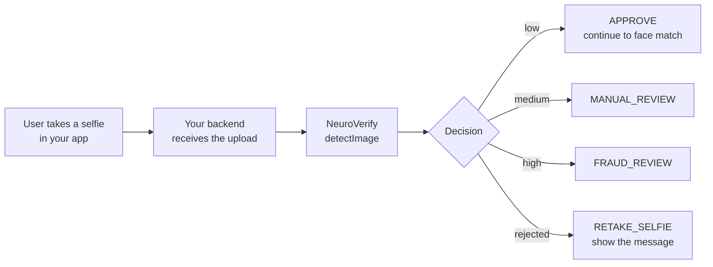

# eKYC onboarding: stop deepfake selfies at sign-up

**Who this is for:** digital banks, fintechs, lenders, crypto exchanges, telecoms, and eKYC
providers that ask new users for a selfie during sign-up.

[← All use cases](README.md)

## The problem

During remote onboarding, a new user takes a selfie so you can match it to their ID
document. Fraudsters attack exactly this step. They hold up a printed photo or a screen,
replay a recorded video, or upload a face generated or swapped by AI. If the selfie passes,
a fake or stolen identity gets a real account.

## Where NeuroVerify fits

Add one check right after the selfie is uploaded and **before** your face-match and
account-approval steps.



> [!IMPORTANT]
> Call NeuroVerify from **your backend**, never directly from the mobile app or web page.
> The app uploads the selfie to your server, and only your server holds the API key.

## The decision

| What NeuroVerify returns | Decision | What your system does |
|---|---|---|
| Rejected (no face, several faces, blurry, wrong format) | `RETAKE_SELFIE` | Show the returned message and ask for a new selfie |
| Risk `low` | `APPROVE` | Continue to face match and the rest of onboarding |
| Risk `medium` | `MANUAL_REVIEW` | Put the application in your review queue |
| Risk `high` | `FRAUD_REVIEW` | Send to your fraud team; do not auto-approve |
| A status this SDK version doesn't recognize | `MANUAL_REVIEW` | Review, and upgrade the SDK |
| Bad input (for example, an empty upload) | `INVALID_INPUT` | Ask the user to upload again |
| NeuroVerify temporarily unreachable | `SERVICE_UNAVAILABLE` | Ask the user to try again in a moment |

A `high` result is a strong reason to review, not proof of fraud. Keep a human in the loop
before you reject a real customer.

## The code

Every SDK below implements exactly the same logic. The function:

1. receives the selfie as bytes, as it arrives from your upload endpoint;
2. calls NeuroVerify once;
3. saves an audit record with the transaction ID;
4. returns the decision.

The outputs are representative; your scores and transaction IDs will differ.

<details open>
<summary><b>Python</b></summary>

```python
"""eKYC onboarding: check a new applicant's selfie before opening an account."""

import json
from datetime import datetime, timezone
from pathlib import Path

from neuraldefend import NeuroVerifyClient, NeuroVerifyError, ValidationError

client = NeuroVerifyClient()  # reads NEURALDEFEND_API_KEY; create once and reuse

DECISIONS = {"low": "APPROVE", "medium": "MANUAL_REVIEW", "high": "FRAUD_REVIEW"}


def save_audit(record):
    print("audit:", json.dumps(record))  # replace with a write to your database


def verify_onboarding_selfie(applicant_id, photo_bytes, filename):
    try:
        result = client.detect_image(photo_bytes, filename=filename)
    except NeuroVerifyError as error:
        # ValidationError means bad input or config; anything else is auth, limits, or outages.
        failed = "INVALID_INPUT" if isinstance(error, ValidationError) else "SERVICE_UNAVAILABLE"
        return {
            "applicant_id": applicant_id,
            "decision": failed,
            "reason": error.detail,
            "transaction_id": None,
        }

    save_audit(
        {
            "subject": applicant_id,
            "transaction_id": result.unique_trx_id,
            "status": result.status,
            "risk_level": result.risk_level,
            "billable": result.billable,
            "timestamp": datetime.now(timezone.utc).isoformat(),
        }
    )

    if result.rejected:  # e.g. no face or a blurry photo
        decision = "RETAKE_SELFIE"
    elif result.scored:
        decision = DECISIONS[result.risk_level]
    else:  # a status this code does not know yet
        decision = "MANUAL_REVIEW"

    return {
        "applicant_id": applicant_id,
        "decision": decision,
        "reason": result.message,
        "transaction_id": result.unique_trx_id,
    }


if __name__ == "__main__":
    photo = Path("selfie.jpg").read_bytes()
    print(json.dumps(verify_onboarding_selfie("app_1001", photo, "selfie.jpg"), indent=2))
```

Output:

```text
audit: {"subject": "app_1001", "transaction_id": "trx_example_image_low", "status": "success", "risk_level": "low", "billable": true, "timestamp": "2026-10-16T09:41:07.512310+00:00"}
{
  "applicant_id": "app_1001",
  "decision": "APPROVE",
  "reason": "Not likely to be Spoof or AI-generated",
  "transaction_id": "trx_example_image_low"
}
```

</details>

<details>
<summary><b>TypeScript (Node.js)</b></summary>

```ts
/**
 * eKYC onboarding: check a new applicant's selfie before opening the account.
 *
 *   export NEURALDEFEND_API_KEY="replace-with-your-api-key"
 *   npx tsx ekyc-onboarding.ts
 */
import { readFile } from "node:fs/promises";
import {
  NeuroVerifyClient,
  NeuroVerifyError,
  ValidationError,
  type ImageResult,
} from "@neuraldefend/sdk";

// Create one client and reuse it. It reads NEURALDEFEND_API_KEY.
const client = new NeuroVerifyClient();

// Stand-in for your database: keep one audit row per API call.
function saveAudit(record: Record<string, unknown>): void {
  console.log("audit:", JSON.stringify(record));
}

const DECISION_BY_RISK = {
  low: "APPROVE",
  medium: "MANUAL_REVIEW",
  high: "FRAUD_REVIEW",
} as const;

async function verifyOnboardingSelfie(
  applicantId: string,
  photoBytes: Uint8Array,
  filename: string,
) {
  let result: ImageResult;
  try {
    result = await client.detectImage(photoBytes, { filename });
  } catch (error) {
    if (error instanceof ValidationError) {
      return {
        applicantId,
        decision: "INVALID_INPUT",
        reason: error.detail,
        transactionId: null,
      };
    }
    if (error instanceof NeuroVerifyError) {
      return {
        applicantId,
        decision: "SERVICE_UNAVAILABLE",
        reason: error.detail,
        transactionId: null,
      };
    }
    throw error;
  }

  saveAudit({
    subject: applicantId,
    transactionId: result.uniqueTrxId,
    status: result.status,
    riskLevel: result.riskLevel,
    billable: result.billable,
    timestamp: new Date().toISOString(),
  });

  let decision: string;
  if (result.status === "rejected") {
    decision = "RETAKE_SELFIE"; // e.g. no face or a blurry photo
  } else if (result.status === "success") {
    decision = DECISION_BY_RISK[result.riskLevel];
  } else {
    decision = "MANUAL_REVIEW"; // a newer status this code does not know yet
  }

  return {
    applicantId,
    decision,
    reason: result.message,
    transactionId: result.uniqueTrxId,
  };
}

const photo = await readFile("selfie.jpg");
const decision = await verifyOnboardingSelfie("app_1001", photo, "selfie.jpg");
console.log(JSON.stringify(decision, null, 2));
```

Output:

```text
audit: {"subject":"app_1001","transactionId":"trx_example_image_low","status":"success","riskLevel":"low","billable":true,"timestamp":"2026-10-16T09:41:07.512Z"}
{
  "applicantId": "app_1001",
  "decision": "APPROVE",
  "reason": "Not likely to be Spoof or AI-generated",
  "transactionId": "trx_example_image_low"
}
```

</details>

<details>
<summary><b>Go</b></summary>

```go
package main

import (
	"context"
	"encoding/json"
	"errors"
	"fmt"
	"log"
	"os"
	"time"

	neuraldefend "github.com/Neural-Defend/NeuralDefend-SDKs/packages/go"
)

// One client for the whole program, created in main.
var client *neuraldefend.Client

type OnboardingDecision struct {
	ApplicantID   string  `json:"applicant_id"`
	Decision      string  `json:"decision"`
	Reason        string  `json:"reason"`
	TransactionID *string `json:"transaction_id"` // null when the API call failed
}

type AuditRecord struct {
	Subject       string  `json:"subject"`
	TransactionID string  `json:"transaction_id"`
	Status        string  `json:"status"`
	RiskLevel     *string `json:"risk_level"` // null when the photo was not scored
	Billable      bool    `json:"billable"`
	Timestamp     string  `json:"timestamp"`
}

// saveAudit stands in for your database: it prints one line per API call.
func saveAudit(record AuditRecord) {
	line, _ := json.Marshal(record)
	fmt.Println("audit:", string(line))
}

// errorDecision maps an SDK error to a decision.
func errorDecision(err error) string {
	var validation *neuraldefend.ValidationError
	if errors.As(err, &validation) {
		return "INVALID_INPUT" // bad or missing input or configuration
	}
	return "SERVICE_UNAVAILABLE" // auth, scope, rate limit, server, timeout, network, protocol
}

func verifyOnboardingSelfie(applicantID string, photoBytes []byte, filename string) OnboardingDecision {
	out := OnboardingDecision{ApplicantID: applicantID}

	result, err := client.DetectImage(context.Background(), neuraldefend.BytesMedia(filename, photoBytes))
	if err != nil {
		out.Decision = errorDecision(err)
		out.Reason = err.Error()
		return out
	}

	saveAudit(AuditRecord{
		Subject:       applicantID,
		TransactionID: result.UniqueTrxID,
		Status:        result.Status,
		RiskLevel:     result.RiskLevel,
		Billable:      result.Billable,
		Timestamp:     time.Now().UTC().Format(time.RFC3339),
	})
	out.Reason = result.Message
	out.TransactionID = &result.UniqueTrxID

	// Status first, then the risk level. Scored() guarantees RiskLevel is not nil.
	switch {
	case result.Rejected():
		out.Decision = "RETAKE_SELFIE"
	case !result.Scored():
		out.Decision = "MANUAL_REVIEW" // a status this code does not know yet
	case *result.RiskLevel == "low":
		out.Decision = "APPROVE"
	case *result.RiskLevel == "medium":
		out.Decision = "MANUAL_REVIEW"
	case *result.RiskLevel == "high":
		out.Decision = "FRAUD_REVIEW"
	default:
		out.Decision = "MANUAL_REVIEW"
	}
	return out
}

func main() {
	var err error
	client, err = neuraldefend.NewClient(neuraldefend.ClientOptions{}) // reads NEURALDEFEND_API_KEY
	if err != nil {
		log.Fatal(err)
	}

	photo, err := os.ReadFile("selfie.jpg") // in a web app: the uploaded bytes
	if err != nil {
		log.Fatal(err)
	}

	decision := verifyOnboardingSelfie("app_1001", photo, "selfie.jpg")
	pretty, _ := json.MarshalIndent(decision, "", "  ")
	fmt.Println(string(pretty))
}
```

Output:

```text
audit: {"subject":"app_1001","transaction_id":"trx_example_image_low","status":"success","risk_level":"low","billable":true,"timestamp":"2026-10-16T09:41:07Z"}
{
  "applicant_id": "app_1001",
  "decision": "APPROVE",
  "reason": "Not likely to be Spoof or AI-generated",
  "transaction_id": "trx_example_image_low"
}
```

</details>

<details>
<summary><b>Java</b></summary>

```java
import com.neuraldefend.AuthenticationException;
import com.neuraldefend.ClientOptions;
import com.neuraldefend.HttpException;
import com.neuraldefend.ImageResult;
import com.neuraldefend.Media;
import com.neuraldefend.NetworkException;
import com.neuraldefend.NeuroVerifyClient;
import com.neuraldefend.ProtocolException;
import com.neuraldefend.RateLimitException;
import com.neuraldefend.ScopeException;
import com.neuraldefend.ServerException;
import com.neuraldefend.ValidationException;
import java.io.IOException;
import java.nio.file.Files;
import java.nio.file.Path;
import java.time.Instant;
import java.time.temporal.ChronoUnit;

public class EkycOnboarding {
    // One client for the whole app. It reads NEURALDEFEND_API_KEY from the environment.
    private static final NeuroVerifyClient CLIENT = NeuroVerifyClient.newClient(new ClientOptions());

    public record OnboardingDecision(
            String applicantId, String decision, String reason, String transactionId) {}

    public record AuditRecord(
            String subject, String transactionId, String status, String riskLevel,
            boolean billable, Instant timestamp) {}

    // Stand-in for your database: one line per API call.
    static void saveAudit(AuditRecord record) {
        System.out.println("audit: " + record);
    }

    public static OnboardingDecision verifyOnboardingSelfie(
            String applicantId, byte[] photoBytes, String filename) {
        ImageResult result;
        try {
            result = CLIENT.detectImage(Media.bytesMedia(filename, photoBytes));
        } catch (ValidationException error) {
            return new OnboardingDecision(applicantId, "INVALID_INPUT", error.getDetail(), null);
        } catch (AuthenticationException | ScopeException | RateLimitException | ServerException
                | com.neuraldefend.TimeoutException | NetworkException | ProtocolException
                | HttpException error) {
            // Every SDK error passes its detail to RuntimeException, so getMessage() returns it.
            return new OnboardingDecision(applicantId, "SERVICE_UNAVAILABLE", error.getMessage(), null);
        }

        saveAudit(new AuditRecord(applicantId, result.uniqueTrxId, result.status, result.riskLevel,
                result.billable, Instant.now().truncatedTo(ChronoUnit.SECONDS)));

        String decision;
        if (result.rejected()) {
            decision = "RETAKE_SELFIE"; // e.g. no face found: ask for a new photo
        } else if (!result.scored()) {
            decision = "MANUAL_REVIEW"; // unknown status: let a person look
        } else {
            decision = switch (result.riskLevel) {
                case "low" -> "APPROVE";
                case "medium" -> "MANUAL_REVIEW";
                case "high" -> "FRAUD_REVIEW";
                default -> "MANUAL_REVIEW";
            };
        }
        return new OnboardingDecision(applicantId, decision, result.message, result.uniqueTrxId);
    }

    public static void main(String[] args) throws IOException {
        byte[] photo = Files.readAllBytes(Path.of("selfie.jpg"));
        System.out.println(verifyOnboardingSelfie("app_1001", photo, "selfie.jpg"));
    }
}
```

Output:

```text
audit: AuditRecord[subject=app_1001, transactionId=trx_example_image_low, status=success, riskLevel=low, billable=true, timestamp=2026-10-16T09:41:07Z]
OnboardingDecision[applicantId=app_1001, decision=APPROVE, reason=Not likely to be Spoof or AI-generated, transactionId=trx_example_image_low]
```

</details>

<details>
<summary><b>Kotlin</b></summary>

```kotlin
import com.neuraldefend.kotlin.MediaInput
import com.neuraldefend.kotlin.NeuroVerifyClient
import com.neuraldefend.kotlin.NeuroVerifyError
import com.neuraldefend.kotlin.ResultStatus
import com.neuraldefend.kotlin.RiskLevel
import com.neuraldefend.kotlin.ValidationError
import java.io.File
import java.time.Instant

data class OnboardingDecision(
    val applicantId: String,
    val decision: String,
    val reason: String,
    val transactionId: String? = null,
)

// Stand-in for your database: store one row per API call.
fun saveAudit(record: Map<String, Any?>) = println("audit: $record")

suspend fun verifyOnboardingSelfie(
    client: NeuroVerifyClient,
    applicantId: String,
    photoBytes: ByteArray,
    filename: String,
): OnboardingDecision {
    val result = try {
        client.detectImage(MediaInput.bytes(photoBytes, filename))
    } catch (error: ValidationError) {
        return OnboardingDecision(applicantId, "INVALID_INPUT", error.detail)
    } catch (error: NeuroVerifyError) {
        return OnboardingDecision(applicantId, "SERVICE_UNAVAILABLE", error.detail)
    }

    saveAudit(
        mapOf(
            "subject" to applicantId,
            "transactionId" to result.uniqueTrxId,
            "status" to result.status.wireValue,
            "riskLevel" to result.riskLevel?.wireValue,
            "billable" to result.billable,
            "timestamp" to Instant.now().toString(),
        ),
    )

    val decision = when (result.status) {
        ResultStatus.REJECTED -> "RETAKE_SELFIE" // no face, blurry, etc.: ask for a new selfie
        ResultStatus.UNKNOWN -> "MANUAL_REVIEW"
        ResultStatus.SUCCESS -> when (result.riskLevel) {
            RiskLevel.LOW -> "APPROVE"
            RiskLevel.MEDIUM -> "MANUAL_REVIEW"
            RiskLevel.HIGH -> "FRAUD_REVIEW"
            null -> "MANUAL_REVIEW"
        }
    }
    return OnboardingDecision(applicantId, decision, result.message, result.uniqueTrxId)
}

suspend fun main() {
    NeuroVerifyClient().use { client -> // reads NEURALDEFEND_API_KEY
        val decision = verifyOnboardingSelfie(client, "app_1001", File("selfie.jpg").readBytes(), "selfie.jpg")
        println(decision)
    }
}
```

Output:

```text
audit: {subject=app_1001, transactionId=trx_example_image_low, status=success, riskLevel=low, billable=true, timestamp=2026-10-16T09:41:07.512310Z}
OnboardingDecision(applicantId=app_1001, decision=APPROVE, reason=Not likely to be Spoof or AI-generated, transactionId=trx_example_image_low)
```

</details>

<details>
<summary><b>Dart</b></summary>

```dart
import 'dart:convert';
import 'dart:io';
import 'dart:typed_data';

import 'package:neuraldefend/neuraldefend.dart';

/// Checks a new applicant's selfie and returns an onboarding decision.
Future<Map<String, Object?>> verifyOnboardingSelfie(
  NeuroVerifyClient client,
  String applicantId,
  Uint8List photoBytes,
  String filename,
) async {
  try {
    final result = await client.detectImage(
      MediaInput.bytes(photoBytes, filename: filename),
    );
    saveAudit({
      'subject': applicantId,
      'transactionId': result.uniqueTrxId,
      'status': result.status.name,
      'riskLevel': result.riskLevel?.name,
      'billable': result.billable,
      'timestamp': DateTime.now().toUtc().toIso8601String(),
    });

    // Check the status first, then the risk level. Never compare raw scores.
    final decision = switch ((result.status, result.riskLevel)) {
      (ResultStatus.rejected, _) => 'RETAKE_SELFIE',
      (ResultStatus.success, RiskLevel.low) => 'APPROVE',
      (ResultStatus.success, RiskLevel.medium) => 'MANUAL_REVIEW',
      (ResultStatus.success, RiskLevel.high) => 'FRAUD_REVIEW',
      _ => 'MANUAL_REVIEW', // a status this SDK version does not know yet
    };
    return {
      'applicantId': applicantId,
      'decision': decision,
      'reason': result.message,
      'transactionId': result.uniqueTrxId,
    };
  } on ValidationError catch (error) {
    // Bad input, such as an empty upload. Fix it; do not retry unchanged.
    return {
      'applicantId': applicantId,
      'decision': 'INVALID_INPUT',
      'reason': error.detail,
      'transactionId': null,
    };
  } on NeuroVerifyError catch (error) {
    // Auth, rate limit, server, timeout, or network problem.
    return {
      'applicantId': applicantId,
      'decision': 'SERVICE_UNAVAILABLE',
      'reason': error.detail,
      'transactionId': null,
    };
  }
}

/// Stand-in for your database: keep one row per transaction.
void saveAudit(Map<String, Object?> record) {
  print('audit: ${jsonEncode(record)}');
}

Future<void> main() async {
  // Reads NEURALDEFEND_API_KEY. Create one client and reuse it.
  final client = NeuroVerifyClient();
  try {
    final photoBytes = await File('selfie.jpg').readAsBytes();
    final decision = await verifyOnboardingSelfie(
      client,
      'app_1001',
      photoBytes,
      'selfie.jpg',
    );
    print(const JsonEncoder.withIndent('  ').convert(decision));
  } finally {
    client.close();
  }
}
```

Output:

```text
audit: {"subject":"app_1001","transactionId":"trx_example_image_low","status":"success","riskLevel":"low","billable":true,"timestamp":"2026-10-16T03:02:51.042267Z"}
{
  "applicantId": "app_1001",
  "decision": "APPROVE",
  "reason": "Not likely to be Spoof or AI-generated",
  "transactionId": "trx_example_image_low"
}
```

</details>

<details>
<summary><b>Swift</b></summary>

```swift
// main.swift
import Foundation
import NeuralDefend

/// The decision returned to the onboarding flow.
struct OnboardingDecision: Encodable, Sendable {
    let applicantId: String
    let decision: String
    let reason: String
    let transactionId: String?  // nil on errors

    private enum CodingKeys: String, CodingKey {
        case applicantId, decision, reason, transactionId
    }

    // Written by hand so a nil transactionId becomes null instead of being left out.
    func encode(to encoder: any Encoder) throws {
        var container = encoder.container(keyedBy: CodingKeys.self)
        try container.encode(applicantId, forKey: .applicantId)
        try container.encode(decision, forKey: .decision)
        try container.encode(reason, forKey: .reason)
        try container.encode(transactionId, forKey: .transactionId)
    }
}

/// One audit row. Stands in for your database table.
struct AuditRecord: Encodable, Sendable {
    let subject: String
    let transactionId: String
    let status: String
    let riskLevel: String?  // nil when the photo was not scored
    let billable: Bool
    let timestamp: String

    private enum CodingKeys: String, CodingKey {
        case subject, transactionId, status, riskLevel, billable, timestamp
    }

    // Written by hand so a nil riskLevel becomes null instead of being left out.
    func encode(to encoder: any Encoder) throws {
        var container = encoder.container(keyedBy: CodingKeys.self)
        try container.encode(subject, forKey: .subject)
        try container.encode(transactionId, forKey: .transactionId)
        try container.encode(status, forKey: .status)
        try container.encode(riskLevel, forKey: .riskLevel)
        try container.encode(billable, forKey: .billable)
        try container.encode(timestamp, forKey: .timestamp)
    }
}

func saveAudit(_ record: AuditRecord) {
    // Replace this print with an insert into your own database.
    let encoder = JSONEncoder()
    encoder.outputFormatting = [.sortedKeys, .withoutEscapingSlashes]
    if let json = try? encoder.encode(record) {
        print("audit: " + String(decoding: json, as: UTF8.self))
    }
}

func verifyOnboardingSelfie(
    client: NeuroVerifyClient,
    applicantId: String,
    photoBytes: Data,
    filename: String
) async -> OnboardingDecision {
    let result: ImageResult
    do {
        result = try await client.detectImage(.data(photoBytes, filename: filename))
    } catch NeuroVerifyError.validation(_, let message) {
        // Bad or missing input or configuration.
        return OnboardingDecision(
            applicantId: applicantId, decision: "INVALID_INPUT", reason: message, transactionId: nil)
    } catch {
        // Any other SDK error: authentication, scope, rate limit, server, timeout, network, protocol.
        let reason = (error as? NeuroVerifyError)?.message ?? String(describing: error)
        return OnboardingDecision(
            applicantId: applicantId, decision: "SERVICE_UNAVAILABLE", reason: reason, transactionId: nil)
    }

    saveAudit(
        AuditRecord(
            subject: applicantId,
            transactionId: result.uniqueTrxID,
            status: result.status.rawValue,
            riskLevel: result.riskLevel?.rawValue,
            billable: result.billable,
            timestamp: ISO8601DateFormatter().string(from: Date())
        ))

    // Status first, then the risk band. Never compare numeric scores.
    let decision =
        switch (result.status, result.riskLevel) {
        case (.rejected, _): "RETAKE_SELFIE"  // for example no face or a blurry photo
        case (.success, .low?): "APPROVE"
        case (.success, .medium?): "MANUAL_REVIEW"
        case (.success, .high?): "FRAUD_REVIEW"
        default: "MANUAL_REVIEW"  // a status this SDK version does not know
        }
    return OnboardingDecision(
        applicantId: applicantId, decision: decision, reason: result.message,
        transactionId: result.uniqueTrxID)
}

let client = try NeuroVerifyClient.fromEnvironment()  // reads NEURALDEFEND_API_KEY
let photo = try Data(contentsOf: URL(fileURLWithPath: "selfie.jpg"))
let outcome = await verifyOnboardingSelfie(
    client: client, applicantId: "app_1001", photoBytes: photo, filename: "selfie.jpg")

let encoder = JSONEncoder()
encoder.outputFormatting = [.prettyPrinted, .sortedKeys, .withoutEscapingSlashes]
print(String(decoding: try encoder.encode(outcome), as: UTF8.self))
```

Output:

```text
audit: {"billable":true,"riskLevel":"low","status":"success","subject":"app_1001","timestamp":"2026-10-16T09:41:07Z","transactionId":"trx_example_image_low"}
{
  "applicantId" : "app_1001",
  "decision" : "APPROVE",
  "reason" : "Not likely to be Spoof or AI-generated",
  "transactionId" : "trx_example_image_low"
}
```

</details>

### Connect it to your upload endpoint

The function takes the uploaded bytes and a filename. To wire it into a web framework, see
the endpoint example in each SDK guide:
[Python (FastAPI)](../../packages/python/README.md#8-add-a-check-to-a-web-api),
[TypeScript (Express)](../../packages/typescript/README.md#8-add-a-check-to-an-express-api),
[Go (net/http)](../../packages/go/README.md#8-add-a-check-to-an-http-handler),
[Java (Spring Boot)](../../packages/java/README.md#8-add-a-check-to-a-web-api),
[Kotlin (Spring Boot)](../../packages/kotlin/README.md#9-add-a-check-to-a-spring-boot-endpoint),
[Dart (shelf)](../../packages/dart/README.md#9-add-a-check-to-a-dart-server).

### Mobile apps

Your Android, iOS, or Flutter app should only **capture and upload** the selfie to your
backend. See the credential-safety notes for
[Android](../../packages/kotlin/README.md#android-credential-safety),
[iOS](../../packages/swift/README.md#get-an-api-key), and
[Flutter](../../packages/dart/README.md#flutter-and-web-credential-safety).

## Production checklist

- [ ] The API key lives only on your backend, in a secret manager or environment variable.
- [ ] You store the `transaction_id` with the application. Support and billing need it.
- [ ] `MANUAL_REVIEW` and `FRAUD_REVIEW` go to a real review queue with trained staff.
- [ ] The user is shown the API's message on `RETAKE_SELFIE`, and you cap retakes per session.
- [ ] You have user consent to process their biometric data, and you follow your retention
      and deletion rules for selfies.
- [ ] You don't retry the same selfie after a rejection. Each call can be billable.
- [ ] You tested the flow with your staging key before going live.

## Related

- [KYC re-verification](kyc-reverification.md): check existing customers before risky actions.
- [Video KYC](video-kyc.md): verify recorded video sessions, including the voice.
- [Image response reference](../client/unified-face-authenticity.md)
