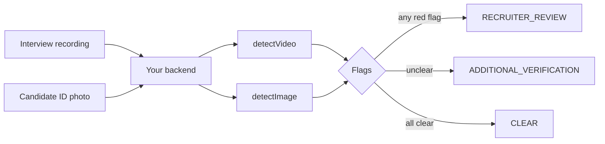

# HR tech: catch deepfake candidates in remote hiring

**Who this is for:** applicant-tracking systems, interview platforms, background-check
providers, staffing agencies, and companies hiring remotely.

[← All use cases](README.md)

## The problem

Remote hiring has a new kind of fraud: **candidates who aren't who they claim to be**. A
stand-in takes the interview using a face swap, someone uses a cloned voice, or the ID
photo is a spoof. Companies have hired people who then turned out to be someone else
entirely.

## Where NeuroVerify fits

Check two things for each candidate: the **interview recording** (face and voice) and the
**ID photo** they submitted. The result is a short list of red flags for the recruiter.



## The flags and the decision

Each `high` risk becomes a clear, named flag:

| Flag | Raised when |
|---|---|
| `FACE_SWAP_SUSPECTED` | The interview's **video** risk is `high` |
| `VOICE_CLONE_SUSPECTED` | The interview's **audio** risk is `high` |
| `PHOTO_SPOOF_SUSPECTED` | The ID photo's risk is `high` |

| Situation | Decision | What your system does |
|---|---|---|
| At least one flag | `RECRUITER_REVIEW` | Show the flags to the recruiter before any offer |
| No flags, but something was `medium`, or a file couldn't be scored | `ADDITIONAL_VERIFICATION` | Ask for a short live re-interview or an in-person ID check |
| Everything `low` | `CLEAR` | Continue the hiring process |
| Bad input | `INVALID_INPUT` | Ask the candidate for a new file |
| NeuroVerify temporarily unreachable | `SERVICE_UNAVAILABLE` | Retry later |

> [!IMPORTANT]
> **Never reject a candidate automatically.** A flag means "a person should look at this",
> not "this person is a fraud". Make sure your process is fair, explainable, and compliant
> with employment and anti-discrimination law in every country where you hire.

## The code

Every SDK below implements exactly the same logic. It makes **two** calls, one for the
interview and one for the photo, so each candidate check is two transactions. The outputs
are representative: here the face and photo look real, but the voice is likely cloned.

<details open>
<summary><b>Python</b></summary>

```python
"""HR tech: screen a remote candidate's interview recording and ID photo."""

import json
from datetime import datetime, timezone
from pathlib import Path

from neuraldefend import NeuroVerifyClient, NeuroVerifyError, ValidationError

client = NeuroVerifyClient()  # reads NEURALDEFEND_API_KEY; create once and reuse


def save_audit(record):
    print("audit:", json.dumps(record))  # replace with a write to your database


def screen_candidate(candidate_id, interview_path, photo_bytes, photo_filename):
    try:
        interview = client.detect_video(interview_path)
        save_audit(
            {
                "subject": candidate_id,
                "transaction_id": interview.unique_trx_id,
                "status": interview.status,
                "video_risk_level": interview.video_risk_level,
                "audio_risk_level": interview.audio_risk_level,
                "billable": interview.billable,
                "timestamp": datetime.now(timezone.utc).isoformat(),
            }
        )
        photo = client.detect_image(photo_bytes, filename=photo_filename)
        save_audit(
            {
                "subject": candidate_id,
                "transaction_id": photo.unique_trx_id,
                "status": photo.status,
                "risk_level": photo.risk_level,
                "billable": photo.billable,
                "timestamp": datetime.now(timezone.utc).isoformat(),
            }
        )
    except NeuroVerifyError as error:
        # ValidationError means bad input or config; anything else is auth, limits, or outages.
        failed = "INVALID_INPUT" if isinstance(error, ValidationError) else "SERVICE_UNAVAILABLE"
        return {
            "candidate_id": candidate_id,
            "decision": failed,
            "flags": [],
            "transaction_ids": [],
            "reason": error.detail,
        }

    flags = []
    if interview.video_risk_level == "high":
        flags.append("FACE_SWAP_SUSPECTED")
    if interview.audio_risk_level == "high":
        flags.append("VOICE_CLONE_SUSPECTED")
    if photo.risk_level == "high":
        flags.append("PHOTO_SPOOF_SUSPECTED")

    levels = (interview.video_risk_level, interview.audio_risk_level, photo.risk_level)
    if flags:
        decision = "RECRUITER_REVIEW"
    elif not interview.scored or not photo.scored or "medium" in levels:
        decision = "ADDITIONAL_VERIFICATION"  # rejected, unknown status, or inconclusive
    else:
        decision = "CLEAR"

    return {
        "candidate_id": candidate_id,
        "decision": decision,
        "flags": flags,
        "transaction_ids": [interview.unique_trx_id, photo.unique_trx_id],
    }


if __name__ == "__main__":
    photo = Path("id_photo.jpg").read_bytes()
    decision = screen_candidate("cand_4004", "interview.mp4", photo, "id_photo.jpg")
    print(json.dumps(decision, indent=2))
```

Output:

```text
audit: {"subject": "cand_4004", "transaction_id": "trx_example_video_modalities", "status": "success", "video_risk_level": "low", "audio_risk_level": "high", "billable": true, "timestamp": "2026-10-16T09:41:07.512310+00:00"}
audit: {"subject": "cand_4004", "transaction_id": "trx_example_image_low", "status": "success", "risk_level": "low", "billable": true, "timestamp": "2026-10-16T09:41:09.204118+00:00"}
{
  "candidate_id": "cand_4004",
  "decision": "RECRUITER_REVIEW",
  "flags": [
    "VOICE_CLONE_SUSPECTED"
  ],
  "transaction_ids": [
    "trx_example_video_modalities",
    "trx_example_image_low"
  ]
}
```

</details>

<details>
<summary><b>TypeScript (Node.js)</b></summary>

```ts
/**
 * HR tech: screen a job candidate's recorded interview and ID photo.
 *
 *   export NEURALDEFEND_API_KEY="replace-with-your-api-key"
 *   npx tsx hr-tech.ts
 */
import { readFile } from "node:fs/promises";
import {
  NeuroVerifyClient,
  NeuroVerifyError,
  ValidationError,
  type ImageResult,
  type VideoResult,
} from "@neuraldefend/sdk";

// Create one client and reuse it. It reads NEURALDEFEND_API_KEY.
const client = new NeuroVerifyClient();

// Stand-in for your database: keep one audit row per API call.
function saveAudit(record: Record<string, unknown>): void {
  console.log("audit:", JSON.stringify(record));
}

async function screenCandidate(
  candidateId: string,
  interviewPath: string,
  photoBytes: Uint8Array,
  photoFilename: string,
) {
  let video: VideoResult;
  let photo: ImageResult;
  try {
    video = await client.detectVideo(interviewPath);
    saveAudit({
      subject: candidateId,
      transactionId: video.uniqueTrxId,
      status: video.status,
      videoRiskLevel: video.videoRiskLevel,
      audioRiskLevel: video.audioRiskLevel,
      billable: video.billable,
      timestamp: new Date().toISOString(),
    });

    photo = await client.detectImage(photoBytes, { filename: photoFilename });
    saveAudit({
      subject: candidateId,
      transactionId: photo.uniqueTrxId,
      status: photo.status,
      riskLevel: photo.riskLevel,
      billable: photo.billable,
      timestamp: new Date().toISOString(),
    });
  } catch (error) {
    if (error instanceof ValidationError) {
      return {
        candidateId,
        decision: "INVALID_INPUT",
        flags: [],
        transactionIds: [],
        reason: error.detail,
      };
    }
    if (error instanceof NeuroVerifyError) {
      return {
        candidateId,
        decision: "SERVICE_UNAVAILABLE",
        flags: [],
        transactionIds: [],
        reason: error.detail,
      };
    }
    throw error;
  }

  const flags: string[] = [];
  if (video.videoRiskLevel === "high") flags.push("FACE_SWAP_SUSPECTED");
  if (video.audioRiskLevel === "high") flags.push("VOICE_CLONE_SUSPECTED");
  if (photo.riskLevel === "high") flags.push("PHOTO_SPOOF_SUSPECTED");

  const levels = [video.videoRiskLevel, video.audioRiskLevel, photo.riskLevel];
  let decision: string;
  if (flags.length > 0) {
    decision = "RECRUITER_REVIEW";
  } else if (
    video.status !== "success" ||
    photo.status !== "success" ||
    levels.includes("medium")
  ) {
    // rejected, a newer status this code does not know yet, or inconclusive
    decision = "ADDITIONAL_VERIFICATION";
  } else {
    decision = "CLEAR";
  }

  return {
    candidateId,
    decision,
    flags,
    transactionIds: [video.uniqueTrxId, photo.uniqueTrxId],
  };
}

const idPhoto = await readFile("id_photo.jpg");
const decision = await screenCandidate(
  "cand_4004",
  "interview.mp4",
  idPhoto,
  "id_photo.jpg",
);
console.log(JSON.stringify(decision, null, 2));
```

Output:

```text
audit: {"subject":"cand_4004","transactionId":"trx_example_video_modalities","status":"success","videoRiskLevel":"low","audioRiskLevel":"high","billable":true,"timestamp":"2026-10-16T09:41:07.512Z"}
audit: {"subject":"cand_4004","transactionId":"trx_example_image_low","status":"success","riskLevel":"low","billable":true,"timestamp":"2026-10-16T09:41:09.204Z"}
{
  "candidateId": "cand_4004",
  "decision": "RECRUITER_REVIEW",
  "flags": [
    "VOICE_CLONE_SUSPECTED"
  ],
  "transactionIds": [
    "trx_example_video_modalities",
    "trx_example_image_low"
  ]
}
```

</details>

<details>
<summary><b>Go</b></summary>

```go
package main

import (
	"context"
	"encoding/json"
	"errors"
	"fmt"
	"log"
	"os"
	"time"

	neuraldefend "github.com/Neural-Defend/NeuralDefend-SDKs/packages/go"
)

// One client for the whole program, created in main.
var client *neuraldefend.Client

type ScreeningDecision struct {
	CandidateID    string   `json:"candidate_id"`
	Decision       string   `json:"decision"`
	Flags          []string `json:"flags"`
	TransactionIDs []string `json:"transaction_ids"`
	Reason         *string  `json:"reason,omitempty"` // only present when an API call failed
}

type VideoAudit struct {
	Subject        string  `json:"subject"`
	TransactionID  string  `json:"transaction_id"`
	Status         string  `json:"status"`
	VideoRiskLevel *string `json:"video_risk_level"`
	AudioRiskLevel *string `json:"audio_risk_level"`
	Billable       bool    `json:"billable"`
	Timestamp      string  `json:"timestamp"`
}

type ImageAudit struct {
	Subject       string  `json:"subject"`
	TransactionID string  `json:"transaction_id"`
	Status        string  `json:"status"`
	RiskLevel     *string `json:"risk_level"`
	Billable      bool    `json:"billable"`
	Timestamp     string  `json:"timestamp"`
}

// saveAudit stands in for your database: it prints one line per API call.
func saveAudit(record any) {
	line, _ := json.Marshal(record)
	fmt.Println("audit:", string(line))
}

// errorDecision maps an SDK error to a decision.
func errorDecision(err error) string {
	var validation *neuraldefend.ValidationError
	if errors.As(err, &validation) {
		return "INVALID_INPUT" // bad or missing input or configuration
	}
	return "SERVICE_UNAVAILABLE" // auth, scope, rate limit, server, timeout, network, protocol
}

// levelIs reports whether a risk level is present and equal to want.
func levelIs(level *string, want string) bool {
	return level != nil && *level == want
}

func screenCandidate(candidateID, interviewPath string, photoBytes []byte, photoFilename string) ScreeningDecision {
	failed := func(err error) ScreeningDecision {
		reason := err.Error()
		return ScreeningDecision{
			CandidateID:    candidateID,
			Decision:       errorDecision(err),
			Flags:          []string{},
			TransactionIDs: []string{},
			Reason:         &reason,
		}
	}
	ctx := context.Background()

	interview, err := client.DetectVideo(ctx, neuraldefend.FileMedia(interviewPath), neuraldefend.VideoOptions{})
	if err != nil {
		return failed(err)
	}
	saveAudit(VideoAudit{
		Subject:        candidateID,
		TransactionID:  interview.UniqueTrxID,
		Status:         interview.Status,
		VideoRiskLevel: interview.VideoRiskLevel,
		AudioRiskLevel: interview.AudioRiskLevel,
		Billable:       interview.Billable,
		Timestamp:      time.Now().UTC().Format(time.RFC3339),
	})

	photo, err := client.DetectImage(ctx, neuraldefend.BytesMedia(photoFilename, photoBytes))
	if err != nil {
		return failed(err)
	}
	saveAudit(ImageAudit{
		Subject:       candidateID,
		TransactionID: photo.UniqueTrxID,
		Status:        photo.Status,
		RiskLevel:     photo.RiskLevel,
		Billable:      photo.Billable,
		Timestamp:     time.Now().UTC().Format(time.RFC3339),
	})

	flags := []string{}
	if levelIs(interview.VideoRiskLevel, "high") {
		flags = append(flags, "FACE_SWAP_SUSPECTED")
	}
	if levelIs(interview.AudioRiskLevel, "high") {
		flags = append(flags, "VOICE_CLONE_SUSPECTED")
	}
	if levelIs(photo.RiskLevel, "high") {
		flags = append(flags, "PHOTO_SPOOF_SUSPECTED")
	}

	decision := "CLEAR"
	switch {
	case len(flags) > 0:
		decision = "RECRUITER_REVIEW"
	case !interview.Scored() || !photo.Scored(): // rejected or an unknown status
		decision = "ADDITIONAL_VERIFICATION"
	case levelIs(interview.VideoRiskLevel, "medium") ||
		levelIs(interview.AudioRiskLevel, "medium") ||
		levelIs(photo.RiskLevel, "medium"):
		decision = "ADDITIONAL_VERIFICATION"
	}

	return ScreeningDecision{
		CandidateID:    candidateID,
		Decision:       decision,
		Flags:          flags,
		TransactionIDs: []string{interview.UniqueTrxID, photo.UniqueTrxID},
	}
}

func main() {
	var err error
	client, err = neuraldefend.NewClient(neuraldefend.ClientOptions{}) // reads NEURALDEFEND_API_KEY
	if err != nil {
		log.Fatal(err)
	}

	idPhoto, err := os.ReadFile("id_photo.jpg") // in a web app: the uploaded bytes
	if err != nil {
		log.Fatal(err)
	}

	decision := screenCandidate("cand_4004", "interview.mp4", idPhoto, "id_photo.jpg")
	pretty, _ := json.MarshalIndent(decision, "", "  ")
	fmt.Println(string(pretty))
}
```

Output:

```text
audit: {"subject":"cand_4004","transaction_id":"trx_example_video_modalities","status":"success","video_risk_level":"low","audio_risk_level":"high","billable":true,"timestamp":"2026-10-16T09:41:07Z"}
audit: {"subject":"cand_4004","transaction_id":"trx_example_image_low","status":"success","risk_level":"low","billable":true,"timestamp":"2026-10-16T09:41:09Z"}
{
  "candidate_id": "cand_4004",
  "decision": "RECRUITER_REVIEW",
  "flags": [
    "VOICE_CLONE_SUSPECTED"
  ],
  "transaction_ids": [
    "trx_example_video_modalities",
    "trx_example_image_low"
  ]
}
```

</details>

<details>
<summary><b>Java</b></summary>

```java
import com.neuraldefend.AuthenticationException;
import com.neuraldefend.ClientOptions;
import com.neuraldefend.HttpException;
import com.neuraldefend.ImageResult;
import com.neuraldefend.Media;
import com.neuraldefend.NetworkException;
import com.neuraldefend.NeuroVerifyClient;
import com.neuraldefend.ProtocolException;
import com.neuraldefend.RateLimitException;
import com.neuraldefend.ScopeException;
import com.neuraldefend.ServerException;
import com.neuraldefend.ValidationException;
import com.neuraldefend.VideoOptions;
import com.neuraldefend.VideoResult;
import java.io.IOException;
import java.nio.file.Files;
import java.nio.file.Path;
import java.time.Instant;
import java.time.temporal.ChronoUnit;
import java.util.ArrayList;
import java.util.List;

public class HrTech {
    // One client for the whole app. It reads NEURALDEFEND_API_KEY from the environment.
    private static final NeuroVerifyClient CLIENT = NeuroVerifyClient.newClient(new ClientOptions());

    // reason is only set when a call fails; it is null for a completed screening.
    public record ScreeningDecision(
            String candidateId, String decision, List<String> flags,
            List<String> transactionIds, String reason) {}

    public record VideoAudit(
            String subject, String transactionId, String status, String videoRiskLevel,
            String audioRiskLevel, boolean billable, Instant timestamp) {}

    public record ImageAudit(
            String subject, String transactionId, String status, String riskLevel,
            boolean billable, Instant timestamp) {}

    // Stand-in for your database: one line per API call (accepts either audit record).
    static void saveAudit(Record record) {
        System.out.println("audit: " + record);
    }

    public static ScreeningDecision screenCandidate(
            String candidateId, String interviewPath, byte[] photoBytes, String photoFilename) {
        VideoResult interview;
        ImageResult photo;
        try {
            interview = CLIENT.detectVideo(Media.fileMedia(interviewPath), new VideoOptions());
            saveAudit(new VideoAudit(candidateId, interview.uniqueTrxId, interview.status,
                    interview.videoRiskLevel, interview.audioRiskLevel, interview.billable,
                    Instant.now().truncatedTo(ChronoUnit.SECONDS)));

            photo = CLIENT.detectImage(Media.bytesMedia(photoFilename, photoBytes));
            saveAudit(new ImageAudit(candidateId, photo.uniqueTrxId, photo.status, photo.riskLevel,
                    photo.billable, Instant.now().truncatedTo(ChronoUnit.SECONDS)));
        } catch (ValidationException error) {
            return new ScreeningDecision(candidateId, "INVALID_INPUT", List.of(), List.of(), error.getDetail());
        } catch (AuthenticationException | ScopeException | RateLimitException | ServerException
                | com.neuraldefend.TimeoutException | NetworkException | ProtocolException
                | HttpException error) {
            // Every SDK error passes its detail to RuntimeException, so getMessage() returns it.
            return new ScreeningDecision(
                    candidateId, "SERVICE_UNAVAILABLE", List.of(), List.of(), error.getMessage());
        }

        List<String> flags = new ArrayList<>();
        if ("high".equals(interview.videoRiskLevel)) {
            flags.add("FACE_SWAP_SUSPECTED");
        }
        if ("high".equals(interview.audioRiskLevel)) {
            flags.add("VOICE_CLONE_SUSPECTED");
        }
        if ("high".equals(photo.riskLevel)) {
            flags.add("PHOTO_SPOOF_SUSPECTED");
        }

        String decision;
        if (!flags.isEmpty()) {
            decision = "RECRUITER_REVIEW";
        } else if (!interview.scored() || !photo.scored()
                || "medium".equals(interview.videoRiskLevel)
                || "medium".equals(interview.audioRiskLevel)
                || "medium".equals(photo.riskLevel)) {
            decision = "ADDITIONAL_VERIFICATION"; // rejected, unknown, or medium risk
        } else {
            decision = "CLEAR";
        }
        return new ScreeningDecision(candidateId, decision, flags,
                List.of(interview.uniqueTrxId, photo.uniqueTrxId), null);
    }

    public static void main(String[] args) throws IOException {
        byte[] photo = Files.readAllBytes(Path.of("id_photo.jpg"));
        System.out.println(screenCandidate("cand_4004", "interview.mp4", photo, "id_photo.jpg"));
    }
}
```

Output:

```text
audit: VideoAudit[subject=cand_4004, transactionId=trx_example_video_modalities, status=success, videoRiskLevel=low, audioRiskLevel=high, billable=true, timestamp=2026-10-16T09:41:07Z]
audit: ImageAudit[subject=cand_4004, transactionId=trx_example_image_low, status=success, riskLevel=low, billable=true, timestamp=2026-10-16T09:41:09Z]
ScreeningDecision[candidateId=cand_4004, decision=RECRUITER_REVIEW, flags=[VOICE_CLONE_SUSPECTED], transactionIds=[trx_example_video_modalities, trx_example_image_low], reason=null]
```

</details>

<details>
<summary><b>Kotlin</b></summary>

```kotlin
import com.neuraldefend.kotlin.ImageResult
import com.neuraldefend.kotlin.MediaInput
import com.neuraldefend.kotlin.NeuroVerifyClient
import com.neuraldefend.kotlin.NeuroVerifyError
import com.neuraldefend.kotlin.ResultStatus
import com.neuraldefend.kotlin.RiskLevel
import com.neuraldefend.kotlin.ValidationError
import com.neuraldefend.kotlin.VideoResult
import java.io.File
import java.time.Instant

data class ScreeningDecision(
    val candidateId: String,
    val decision: String,
    val flags: List<String>,
    val transactionIds: List<String>,
    val reason: String? = null, // set only when an error stopped the check
)

// Stand-in for your database: store one row per API call.
fun saveAudit(record: Map<String, Any?>) = println("audit: $record")

suspend fun screenCandidate(
    client: NeuroVerifyClient,
    candidateId: String,
    interviewPath: String,
    photoBytes: ByteArray,
    photoFilename: String,
): ScreeningDecision {
    val video: VideoResult
    val photo: ImageResult
    try {
        video = client.detectVideo(MediaInput.file(File(interviewPath)))
        saveAudit(
            mapOf(
                "subject" to candidateId,
                "transactionId" to video.uniqueTrxId,
                "status" to video.status.wireValue,
                "videoRiskLevel" to video.videoRiskLevel?.wireValue,
                "audioRiskLevel" to video.audioRiskLevel?.wireValue,
                "billable" to video.billable,
                "timestamp" to Instant.now().toString(),
            ),
        )

        photo = client.detectImage(MediaInput.bytes(photoBytes, photoFilename))
        saveAudit(
            mapOf(
                "subject" to candidateId,
                "transactionId" to photo.uniqueTrxId,
                "status" to photo.status.wireValue,
                "riskLevel" to photo.riskLevel?.wireValue,
                "billable" to photo.billable,
                "timestamp" to Instant.now().toString(),
            ),
        )
    } catch (error: ValidationError) {
        return ScreeningDecision(candidateId, "INVALID_INPUT", emptyList(), emptyList(), error.detail)
    } catch (error: NeuroVerifyError) {
        return ScreeningDecision(candidateId, "SERVICE_UNAVAILABLE", emptyList(), emptyList(), error.detail)
    }

    val flags = mutableListOf<String>()
    if (video.videoRiskLevel == RiskLevel.HIGH) flags.add("FACE_SWAP_SUSPECTED")
    if (video.audioRiskLevel == RiskLevel.HIGH) flags.add("VOICE_CLONE_SUSPECTED")
    if (photo.riskLevel == RiskLevel.HIGH) flags.add("PHOTO_SPOOF_SUSPECTED")

    val anyMedium = video.videoRiskLevel == RiskLevel.MEDIUM ||
        video.audioRiskLevel == RiskLevel.MEDIUM ||
        photo.riskLevel == RiskLevel.MEDIUM
    val decision = when {
        flags.isNotEmpty() -> "RECRUITER_REVIEW"
        // Rejected or unknown results were not scored, so ask for more evidence.
        video.status != ResultStatus.SUCCESS || photo.status != ResultStatus.SUCCESS || anyMedium ->
            "ADDITIONAL_VERIFICATION"
        else -> "CLEAR"
    }
    return ScreeningDecision(candidateId, decision, flags, listOf(video.uniqueTrxId, photo.uniqueTrxId))
}

suspend fun main() {
    NeuroVerifyClient().use { client -> // reads NEURALDEFEND_API_KEY
        val decision = screenCandidate(
            client, "cand_4004", "interview.mp4", File("id_photo.jpg").readBytes(), "id_photo.jpg",
        )
        println(decision)
    }
}
```

Output:

```text
audit: {subject=cand_4004, transactionId=trx_example_video_modalities, status=success, videoRiskLevel=low, audioRiskLevel=high, billable=true, timestamp=2026-10-16T09:41:07.512310Z}
audit: {subject=cand_4004, transactionId=trx_example_image_low, status=success, riskLevel=low, billable=true, timestamp=2026-10-16T09:41:08.104277Z}
ScreeningDecision(candidateId=cand_4004, decision=RECRUITER_REVIEW, flags=[VOICE_CLONE_SUSPECTED], transactionIds=[trx_example_video_modalities, trx_example_image_low], reason=null)
```

</details>

<details>
<summary><b>Dart</b></summary>

```dart
import 'dart:convert';
import 'dart:io';
import 'dart:typed_data';

import 'package:neuraldefend/neuraldefend.dart';

/// Screens a job candidate's interview recording and ID photo.
Future<Map<String, Object?>> screenCandidate(
  NeuroVerifyClient client,
  String candidateId,
  String interviewPath,
  Uint8List photoBytes,
  String photoFilename,
) async {
  try {
    final video = await client.detectVideo(MediaInput.file(interviewPath));
    saveAudit({
      'subject': candidateId,
      'transactionId': video.uniqueTrxId,
      'status': video.status.name,
      'videoRiskLevel': video.videoRiskLevel?.name,
      'audioRiskLevel': video.audioRiskLevel?.name,
      'billable': video.billable,
      'timestamp': DateTime.now().toUtc().toIso8601String(),
    });

    final photo = await client.detectImage(
      MediaInput.bytes(photoBytes, filename: photoFilename),
    );
    saveAudit({
      'subject': candidateId,
      'transactionId': photo.uniqueTrxId,
      'status': photo.status.name,
      'riskLevel': photo.riskLevel?.name,
      'billable': photo.billable,
      'timestamp': DateTime.now().toUtc().toIso8601String(),
    });

    final flags = [
      if (video.videoRiskLevel == RiskLevel.high) 'FACE_SWAP_SUSPECTED',
      if (video.audioRiskLevel == RiskLevel.high) 'VOICE_CLONE_SUSPECTED',
      if (photo.riskLevel == RiskLevel.high) 'PHOTO_SPOOF_SUSPECTED',
    ];
    final levels = [
      video.videoRiskLevel,
      video.audioRiskLevel,
      photo.riskLevel
    ];
    final String decision;
    if (flags.isNotEmpty) {
      decision = 'RECRUITER_REVIEW';
    } else if (!video.scored ||
        !photo.scored ||
        levels.contains(RiskLevel.medium)) {
      // "Not scored" covers rejected media and statuses this SDK does not know.
      decision = 'ADDITIONAL_VERIFICATION';
    } else {
      decision = 'CLEAR';
    }
    return {
      'candidateId': candidateId,
      'decision': decision,
      'flags': flags,
      'transactionIds': [video.uniqueTrxId, photo.uniqueTrxId],
    };
  } on ValidationError catch (error) {
    // Bad input, such as a missing or empty file. Fix it; do not retry unchanged.
    return {
      'candidateId': candidateId,
      'decision': 'INVALID_INPUT',
      'flags': <String>[],
      'transactionIds': <String>[],
      'reason': error.detail,
    };
  } on NeuroVerifyError catch (error) {
    // Auth, rate limit, server, timeout, or network problem.
    return {
      'candidateId': candidateId,
      'decision': 'SERVICE_UNAVAILABLE',
      'flags': <String>[],
      'transactionIds': <String>[],
      'reason': error.detail,
    };
  }
}

/// Stand-in for your database: keep one row per transaction.
void saveAudit(Map<String, Object?> record) {
  print('audit: ${jsonEncode(record)}');
}

Future<void> main() async {
  // Reads NEURALDEFEND_API_KEY. Create one client and reuse it.
  final client = NeuroVerifyClient();
  try {
    final photoBytes = await File('id_photo.jpg').readAsBytes();
    final decision = await screenCandidate(
      client,
      'cand_4004',
      'interview.mp4',
      photoBytes,
      'id_photo.jpg',
    );
    print(const JsonEncoder.withIndent('  ').convert(decision));
  } finally {
    client.close();
  }
}
```

Output:

```text
audit: {"subject":"cand_4004","transactionId":"trx_example_video_modalities","status":"success","videoRiskLevel":"low","audioRiskLevel":"high","billable":true,"timestamp":"2026-10-16T03:02:51.047059Z"}
audit: {"subject":"cand_4004","transactionId":"trx_example_image_low","status":"success","riskLevel":"low","billable":true,"timestamp":"2026-10-16T03:02:51.048522Z"}
{
  "candidateId": "cand_4004",
  "decision": "RECRUITER_REVIEW",
  "flags": [
    "VOICE_CLONE_SUSPECTED"
  ],
  "transactionIds": [
    "trx_example_video_modalities",
    "trx_example_image_low"
  ]
}
```

</details>

<details>
<summary><b>Swift</b></summary>

```swift
// main.swift
import Foundation
import NeuralDefend

/// The screening result shown to the recruiter.
struct CandidateDecision: Encodable, Sendable {
    let candidateId: String
    let decision: String
    let flags: [String]
    let transactionIds: [String]
    let reason: String?  // set only on errors; on success it is nil and left out of the JSON
}

/// Audit row for the interview video. Stands in for your database table.
struct VideoAuditRecord: Encodable, Sendable {
    let subject: String
    let transactionId: String
    let status: String
    let videoRiskLevel: String?
    let audioRiskLevel: String?
    let billable: Bool
    let timestamp: String

    private enum CodingKeys: String, CodingKey {
        case subject, transactionId, status, videoRiskLevel, audioRiskLevel, billable, timestamp
    }

    // Written by hand so nil risk levels become null instead of being left out.
    func encode(to encoder: any Encoder) throws {
        var container = encoder.container(keyedBy: CodingKeys.self)
        try container.encode(subject, forKey: .subject)
        try container.encode(transactionId, forKey: .transactionId)
        try container.encode(status, forKey: .status)
        try container.encode(videoRiskLevel, forKey: .videoRiskLevel)
        try container.encode(audioRiskLevel, forKey: .audioRiskLevel)
        try container.encode(billable, forKey: .billable)
        try container.encode(timestamp, forKey: .timestamp)
    }
}

/// Audit row for the ID photo. Stands in for your database table.
struct ImageAuditRecord: Encodable, Sendable {
    let subject: String
    let transactionId: String
    let status: String
    let riskLevel: String?
    let billable: Bool
    let timestamp: String

    private enum CodingKeys: String, CodingKey {
        case subject, transactionId, status, riskLevel, billable, timestamp
    }

    // Written by hand so a nil riskLevel becomes null instead of being left out.
    func encode(to encoder: any Encoder) throws {
        var container = encoder.container(keyedBy: CodingKeys.self)
        try container.encode(subject, forKey: .subject)
        try container.encode(transactionId, forKey: .transactionId)
        try container.encode(status, forKey: .status)
        try container.encode(riskLevel, forKey: .riskLevel)
        try container.encode(billable, forKey: .billable)
        try container.encode(timestamp, forKey: .timestamp)
    }
}

func saveAudit(_ record: some Encodable) {
    // Replace this print with an insert into your own database.
    let encoder = JSONEncoder()
    encoder.outputFormatting = [.sortedKeys, .withoutEscapingSlashes]
    if let json = try? encoder.encode(record) {
        print("audit: " + String(decoding: json, as: UTF8.self))
    }
}

func screenCandidate(
    client: NeuroVerifyClient,
    candidateId: String,
    interviewPath: String,
    photoBytes: Data,
    photoFilename: String
) async -> CandidateDecision {
    let video: VideoResult
    let photo: ImageResult
    do {
        // A file input is streamed from disk, so a long interview is never loaded into memory.
        video = try await client.detectVideo(.file(URL(fileURLWithPath: interviewPath)))
        saveAudit(
            VideoAuditRecord(
                subject: candidateId,
                transactionId: video.uniqueTrxID,
                status: video.status.rawValue,
                videoRiskLevel: video.videoRiskLevel?.rawValue,
                audioRiskLevel: video.audioRiskLevel?.rawValue,
                billable: video.billable,
                timestamp: ISO8601DateFormatter().string(from: Date())
            ))

        photo = try await client.detectImage(.data(photoBytes, filename: photoFilename))
        saveAudit(
            ImageAuditRecord(
                subject: candidateId,
                transactionId: photo.uniqueTrxID,
                status: photo.status.rawValue,
                riskLevel: photo.riskLevel?.rawValue,
                billable: photo.billable,
                timestamp: ISO8601DateFormatter().string(from: Date())
            ))
    } catch NeuroVerifyError.validation(_, let message) {
        // Bad or missing input or configuration.
        return CandidateDecision(
            candidateId: candidateId, decision: "INVALID_INPUT", flags: [], transactionIds: [],
            reason: message)
    } catch {
        // Any other SDK error: authentication, scope, rate limit, server, timeout, network, protocol.
        let reason = (error as? NeuroVerifyError)?.message ?? String(describing: error)
        return CandidateDecision(
            candidateId: candidateId, decision: "SERVICE_UNAVAILABLE", flags: [], transactionIds: [],
            reason: reason)
    }

    // Flags are built in this order. Risk levels are nil when a result was not scored.
    var flags: [String] = []
    if video.videoRiskLevel == .high { flags.append("FACE_SWAP_SUSPECTED") }
    if video.audioRiskLevel == .high { flags.append("VOICE_CLONE_SUSPECTED") }
    if photo.riskLevel == .high { flags.append("PHOTO_SPOOF_SUSPECTED") }

    let anyMedium =
        video.videoRiskLevel == .medium || video.audioRiskLevel == .medium
        || photo.riskLevel == .medium
    let decision: String
    if !flags.isEmpty {
        decision = "RECRUITER_REVIEW"
    } else if !video.isScored || !photo.isScored || anyMedium {
        decision = "ADDITIONAL_VERIFICATION"  // rejected, unknown status, or a medium band
    } else {
        decision = "CLEAR"
    }
    return CandidateDecision(
        candidateId: candidateId, decision: decision, flags: flags,
        transactionIds: [video.uniqueTrxID, photo.uniqueTrxID], reason: nil)
}

let client = try NeuroVerifyClient.fromEnvironment()  // reads NEURALDEFEND_API_KEY
let idPhoto = try Data(contentsOf: URL(fileURLWithPath: "id_photo.jpg"))
let outcome = await screenCandidate(
    client: client, candidateId: "cand_4004", interviewPath: "interview.mp4",
    photoBytes: idPhoto, photoFilename: "id_photo.jpg")

let encoder = JSONEncoder()
encoder.outputFormatting = [.prettyPrinted, .sortedKeys, .withoutEscapingSlashes]
print(String(decoding: try encoder.encode(outcome), as: UTF8.self))
```

Output:

```text
audit: {"audioRiskLevel":"high","billable":true,"status":"success","subject":"cand_4004","timestamp":"2026-10-16T09:41:07Z","transactionId":"trx_example_video_modalities","videoRiskLevel":"low"}
audit: {"billable":true,"riskLevel":"low","status":"success","subject":"cand_4004","timestamp":"2026-10-16T09:41:09Z","transactionId":"trx_example_image_low"}
{
  "candidateId" : "cand_4004",
  "decision" : "RECRUITER_REVIEW",
  "flags" : [
    "VOICE_CLONE_SUSPECTED"
  ],
  "transactionIds" : [
    "trx_example_video_modalities",
    "trx_example_image_low"
  ]
}
```

</details>

## Production checklist

- [ ] Candidates are told, in your privacy notice, that interviews and ID photos are checked
      for manipulation, and you have their consent.
- [ ] Recruiters see the flags and the reason, and can request additional verification.
- [ ] No hiring decision is made by the code alone.
- [ ] You store both `transaction_ids` with the candidate record.
- [ ] Recordings and photos are deleted according to your retention policy.
- [ ] The API key lives only on your backend.

## Related

- [Video conferencing](video-conferencing.md): checks during live interviews.
- [Video KYC](video-kyc.md): similar face-and-voice checks for identity verification.
