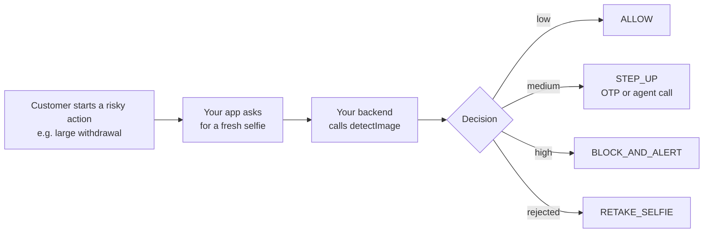

# KYC re-verification: confirm it's really your customer before risky actions

**Who this is for:** banks, wallets, brokers, marketplaces, and any platform that asks
existing customers to prove who they are again, for example before a large withdrawal, a
password or phone-number change, or during periodic KYC refresh.

[← All use cases](README.md)

## The problem

Account takeover often starts after onboarding. An attacker who has a customer's password
still has to get past the selfie check you ask for before a risky action. To do that, they
use a photo of the victim from social media, a screen replay, or an AI-generated face.

## Where NeuroVerify fits

When a risky action starts, ask for a fresh selfie, check it, and only let the action
continue when the risk is low.



Many teams also compare the new selfie with the one stored at onboarding (face match).
NeuroVerify answers a different question: **is this selfie a real, live face, or a spoof or
AI fake?** Run both checks.

## The decision

| What NeuroVerify returns | Decision | What your system does |
|---|---|---|
| Rejected (no face, several faces, blurry, wrong format) | `RETAKE_SELFIE` | Show the message and ask for a new selfie |
| Risk `low` | `ALLOW` | Let the action continue |
| Risk `medium` | `STEP_UP` | Ask for another factor, such as an OTP or a call with an agent |
| Risk `high` | `BLOCK_AND_ALERT` | Stop the action, alert your fraud team, and notify the customer through a trusted channel |
| A status this SDK version doesn't recognize | `STEP_UP` | Ask for another factor, and upgrade the SDK |
| Bad input | `INVALID_INPUT` | Ask the customer to upload again |
| NeuroVerify temporarily unreachable | `SERVICE_UNAVAILABLE` | **Fail safe:** don't silently allow the action; use `STEP_UP` or ask them to retry |

## The code

Every SDK below implements exactly the same logic. `action` names what triggered the check,
so your audit trail shows why the customer was asked to re-verify. The outputs are
representative.

<details open>
<summary><b>Python</b></summary>

```python
"""KYC re-verification: confirm an existing customer before a sensitive action."""

import json
from datetime import datetime, timezone
from pathlib import Path

from neuraldefend import NeuroVerifyClient, NeuroVerifyError, ValidationError

client = NeuroVerifyClient()  # reads NEURALDEFEND_API_KEY; create once and reuse

DECISIONS = {"low": "ALLOW", "medium": "STEP_UP", "high": "BLOCK_AND_ALERT"}


def save_audit(record):
    print("audit:", json.dumps(record))  # replace with a write to your database


def reverify_customer(customer_id, action, photo_bytes, filename):
    try:
        result = client.detect_image(photo_bytes, filename=filename)
    except NeuroVerifyError as error:
        # ValidationError means bad input or config; anything else is auth, limits, or outages.
        failed = "INVALID_INPUT" if isinstance(error, ValidationError) else "SERVICE_UNAVAILABLE"
        return {
            "customer_id": customer_id,
            "action": action,
            "decision": failed,
            "reason": error.detail,
            "transaction_id": None,
        }

    save_audit(
        {
            "subject": customer_id,
            "transaction_id": result.unique_trx_id,
            "status": result.status,
            "risk_level": result.risk_level,
            "billable": result.billable,
            "timestamp": datetime.now(timezone.utc).isoformat(),
        }
    )

    if result.rejected:  # e.g. no face or a blurry photo
        decision = "RETAKE_SELFIE"
    elif result.scored:
        decision = DECISIONS[result.risk_level]
    else:  # a status this code does not know yet
        decision = "STEP_UP"

    return {
        "customer_id": customer_id,
        "action": action,
        "decision": decision,
        "reason": result.message,
        "transaction_id": result.unique_trx_id,
    }


if __name__ == "__main__":
    photo = Path("selfie.jpg").read_bytes()
    decision = reverify_customer("cus_2002", "large_withdrawal", photo, "selfie.jpg")
    print(json.dumps(decision, indent=2))
```

Output:

```text
audit: {"subject": "cus_2002", "transaction_id": "trx_example_image_high", "status": "success", "risk_level": "high", "billable": true, "timestamp": "2026-10-16T09:41:07.512310+00:00"}
{
  "customer_id": "cus_2002",
  "action": "large_withdrawal",
  "decision": "BLOCK_AND_ALERT",
  "reason": "Likely to be Spoof detected",
  "transaction_id": "trx_example_image_high"
}
```

</details>

<details>
<summary><b>TypeScript (Node.js)</b></summary>

```ts
/**
 * KYC re-verification: ask an existing customer for a fresh selfie before a
 * sensitive action such as a large withdrawal.
 *
 *   export NEURALDEFEND_API_KEY="replace-with-your-api-key"
 *   npx tsx kyc-reverification.ts
 */
import { readFile } from "node:fs/promises";
import {
  NeuroVerifyClient,
  NeuroVerifyError,
  ValidationError,
  type ImageResult,
} from "@neuraldefend/sdk";

// Create one client and reuse it. It reads NEURALDEFEND_API_KEY.
const client = new NeuroVerifyClient();

// Stand-in for your database: keep one audit row per API call.
function saveAudit(record: Record<string, unknown>): void {
  console.log("audit:", JSON.stringify(record));
}

const DECISION_BY_RISK = {
  low: "ALLOW",
  medium: "STEP_UP",
  high: "BLOCK_AND_ALERT",
} as const;

async function reverifyCustomer(
  customerId: string,
  action: string,
  photoBytes: Uint8Array,
  filename: string,
) {
  let result: ImageResult;
  try {
    result = await client.detectImage(photoBytes, { filename });
  } catch (error) {
    if (error instanceof ValidationError) {
      return {
        customerId,
        action,
        decision: "INVALID_INPUT",
        reason: error.detail,
        transactionId: null,
      };
    }
    if (error instanceof NeuroVerifyError) {
      return {
        customerId,
        action,
        decision: "SERVICE_UNAVAILABLE",
        reason: error.detail,
        transactionId: null,
      };
    }
    throw error;
  }

  saveAudit({
    subject: customerId,
    transactionId: result.uniqueTrxId,
    status: result.status,
    riskLevel: result.riskLevel,
    billable: result.billable,
    timestamp: new Date().toISOString(),
  });

  let decision: string;
  if (result.status === "rejected") {
    decision = "RETAKE_SELFIE"; // e.g. no face or a blurry photo
  } else if (result.status === "success") {
    decision = DECISION_BY_RISK[result.riskLevel];
  } else {
    decision = "STEP_UP"; // a newer status this code does not know yet
  }

  return {
    customerId,
    action,
    decision,
    reason: result.message,
    transactionId: result.uniqueTrxId,
  };
}

const photo = await readFile("selfie.jpg");
const decision = await reverifyCustomer(
  "cus_2002",
  "large_withdrawal",
  photo,
  "selfie.jpg",
);
console.log(JSON.stringify(decision, null, 2));
```

Output:

```text
audit: {"subject":"cus_2002","transactionId":"trx_example_image_high","status":"success","riskLevel":"high","billable":true,"timestamp":"2026-10-16T09:41:07.512Z"}
{
  "customerId": "cus_2002",
  "action": "large_withdrawal",
  "decision": "BLOCK_AND_ALERT",
  "reason": "Likely to be Spoof detected",
  "transactionId": "trx_example_image_high"
}
```

</details>

<details>
<summary><b>Go</b></summary>

```go
package main

import (
	"context"
	"encoding/json"
	"errors"
	"fmt"
	"log"
	"os"
	"time"

	neuraldefend "github.com/Neural-Defend/NeuralDefend-SDKs/packages/go"
)

// One client for the whole program, created in main.
var client *neuraldefend.Client

type ReverifyDecision struct {
	CustomerID    string  `json:"customer_id"`
	Action        string  `json:"action"`
	Decision      string  `json:"decision"`
	Reason        string  `json:"reason"`
	TransactionID *string `json:"transaction_id"` // null when the API call failed
}

type AuditRecord struct {
	Subject       string  `json:"subject"`
	TransactionID string  `json:"transaction_id"`
	Status        string  `json:"status"`
	RiskLevel     *string `json:"risk_level"` // null when the photo was not scored
	Billable      bool    `json:"billable"`
	Timestamp     string  `json:"timestamp"`
}

// saveAudit stands in for your database: it prints one line per API call.
func saveAudit(record AuditRecord) {
	line, _ := json.Marshal(record)
	fmt.Println("audit:", string(line))
}

// errorDecision maps an SDK error to a decision.
func errorDecision(err error) string {
	var validation *neuraldefend.ValidationError
	if errors.As(err, &validation) {
		return "INVALID_INPUT" // bad or missing input or configuration
	}
	return "SERVICE_UNAVAILABLE" // auth, scope, rate limit, server, timeout, network, protocol
}

// reverifyCustomer re-checks a known customer before a sensitive action.
func reverifyCustomer(customerID, action string, photoBytes []byte, filename string) ReverifyDecision {
	out := ReverifyDecision{CustomerID: customerID, Action: action}

	result, err := client.DetectImage(context.Background(), neuraldefend.BytesMedia(filename, photoBytes))
	if err != nil {
		out.Decision = errorDecision(err)
		out.Reason = err.Error()
		return out
	}

	saveAudit(AuditRecord{
		Subject:       customerID,
		TransactionID: result.UniqueTrxID,
		Status:        result.Status,
		RiskLevel:     result.RiskLevel,
		Billable:      result.Billable,
		Timestamp:     time.Now().UTC().Format(time.RFC3339),
	})
	out.Reason = result.Message
	out.TransactionID = &result.UniqueTrxID

	// Status first, then the risk level. Scored() guarantees RiskLevel is not nil.
	switch {
	case result.Rejected():
		out.Decision = "RETAKE_SELFIE"
	case !result.Scored():
		out.Decision = "STEP_UP" // a status this code does not know yet
	case *result.RiskLevel == "low":
		out.Decision = "ALLOW"
	case *result.RiskLevel == "medium":
		out.Decision = "STEP_UP"
	case *result.RiskLevel == "high":
		out.Decision = "BLOCK_AND_ALERT"
	default:
		out.Decision = "STEP_UP"
	}
	return out
}

func main() {
	var err error
	client, err = neuraldefend.NewClient(neuraldefend.ClientOptions{}) // reads NEURALDEFEND_API_KEY
	if err != nil {
		log.Fatal(err)
	}

	photo, err := os.ReadFile("selfie.jpg") // in a web app: the uploaded bytes
	if err != nil {
		log.Fatal(err)
	}

	decision := reverifyCustomer("cus_2002", "large_withdrawal", photo, "selfie.jpg")
	pretty, _ := json.MarshalIndent(decision, "", "  ")
	fmt.Println(string(pretty))
}
```

Output:

```text
audit: {"subject":"cus_2002","transaction_id":"trx_example_image_high","status":"success","risk_level":"high","billable":true,"timestamp":"2026-10-16T09:41:07Z"}
{
  "customer_id": "cus_2002",
  "action": "large_withdrawal",
  "decision": "BLOCK_AND_ALERT",
  "reason": "Likely to be Spoof detected",
  "transaction_id": "trx_example_image_high"
}
```

</details>

<details>
<summary><b>Java</b></summary>

```java
import com.neuraldefend.AuthenticationException;
import com.neuraldefend.ClientOptions;
import com.neuraldefend.HttpException;
import com.neuraldefend.ImageResult;
import com.neuraldefend.Media;
import com.neuraldefend.NetworkException;
import com.neuraldefend.NeuroVerifyClient;
import com.neuraldefend.ProtocolException;
import com.neuraldefend.RateLimitException;
import com.neuraldefend.ScopeException;
import com.neuraldefend.ServerException;
import com.neuraldefend.ValidationException;
import java.io.IOException;
import java.nio.file.Files;
import java.nio.file.Path;
import java.time.Instant;
import java.time.temporal.ChronoUnit;

public class KycReverification {
    // One client for the whole app. It reads NEURALDEFEND_API_KEY from the environment.
    private static final NeuroVerifyClient CLIENT = NeuroVerifyClient.newClient(new ClientOptions());

    public record ReverificationDecision(
            String customerId, String action, String decision, String reason, String transactionId) {}

    public record AuditRecord(
            String subject, String transactionId, String status, String riskLevel,
            boolean billable, Instant timestamp) {}

    // Stand-in for your database: one line per API call.
    static void saveAudit(AuditRecord record) {
        System.out.println("audit: " + record);
    }

    public static ReverificationDecision reverifyCustomer(
            String customerId, String action, byte[] photoBytes, String filename) {
        ImageResult result;
        try {
            result = CLIENT.detectImage(Media.bytesMedia(filename, photoBytes));
        } catch (ValidationException error) {
            return new ReverificationDecision(customerId, action, "INVALID_INPUT", error.getDetail(), null);
        } catch (AuthenticationException | ScopeException | RateLimitException | ServerException
                | com.neuraldefend.TimeoutException | NetworkException | ProtocolException
                | HttpException error) {
            // Every SDK error passes its detail to RuntimeException, so getMessage() returns it.
            return new ReverificationDecision(
                    customerId, action, "SERVICE_UNAVAILABLE", error.getMessage(), null);
        }

        saveAudit(new AuditRecord(customerId, result.uniqueTrxId, result.status, result.riskLevel,
                result.billable, Instant.now().truncatedTo(ChronoUnit.SECONDS)));

        String decision;
        if (result.rejected()) {
            decision = "RETAKE_SELFIE"; // e.g. no face found: ask for a new photo
        } else if (!result.scored()) {
            decision = "STEP_UP"; // unknown status: ask for another factor
        } else {
            decision = switch (result.riskLevel) {
                case "low" -> "ALLOW";
                case "medium" -> "STEP_UP";
                case "high" -> "BLOCK_AND_ALERT";
                default -> "STEP_UP";
            };
        }
        return new ReverificationDecision(customerId, action, decision, result.message, result.uniqueTrxId);
    }

    public static void main(String[] args) throws IOException {
        byte[] photo = Files.readAllBytes(Path.of("selfie.jpg"));
        System.out.println(reverifyCustomer("cus_2002", "large_withdrawal", photo, "selfie.jpg"));
    }
}
```

Output:

```text
audit: AuditRecord[subject=cus_2002, transactionId=trx_example_image_high, status=success, riskLevel=high, billable=true, timestamp=2026-10-16T09:41:07Z]
ReverificationDecision[customerId=cus_2002, action=large_withdrawal, decision=BLOCK_AND_ALERT, reason=Likely to be Spoof detected, transactionId=trx_example_image_high]
```

</details>

<details>
<summary><b>Kotlin</b></summary>

```kotlin
import com.neuraldefend.kotlin.MediaInput
import com.neuraldefend.kotlin.NeuroVerifyClient
import com.neuraldefend.kotlin.NeuroVerifyError
import com.neuraldefend.kotlin.ResultStatus
import com.neuraldefend.kotlin.RiskLevel
import com.neuraldefend.kotlin.ValidationError
import java.io.File
import java.time.Instant

data class ReverificationDecision(
    val customerId: String,
    val action: String,
    val decision: String,
    val reason: String,
    val transactionId: String? = null,
)

// Stand-in for your database: store one row per API call.
fun saveAudit(record: Map<String, Any?>) = println("audit: $record")

suspend fun reverifyCustomer(
    client: NeuroVerifyClient,
    customerId: String,
    action: String, // what triggered the check, e.g. "large_withdrawal"
    photoBytes: ByteArray,
    filename: String,
): ReverificationDecision {
    val result = try {
        client.detectImage(MediaInput.bytes(photoBytes, filename))
    } catch (error: ValidationError) {
        return ReverificationDecision(customerId, action, "INVALID_INPUT", error.detail)
    } catch (error: NeuroVerifyError) {
        return ReverificationDecision(customerId, action, "SERVICE_UNAVAILABLE", error.detail)
    }

    saveAudit(
        mapOf(
            "subject" to customerId,
            "transactionId" to result.uniqueTrxId,
            "status" to result.status.wireValue,
            "riskLevel" to result.riskLevel?.wireValue,
            "billable" to result.billable,
            "timestamp" to Instant.now().toString(),
        ),
    )

    val decision = when (result.status) {
        ResultStatus.REJECTED -> "RETAKE_SELFIE"
        ResultStatus.UNKNOWN -> "STEP_UP"
        ResultStatus.SUCCESS -> when (result.riskLevel) {
            RiskLevel.LOW -> "ALLOW"
            RiskLevel.MEDIUM -> "STEP_UP" // e.g. ask for an extra factor
            RiskLevel.HIGH -> "BLOCK_AND_ALERT"
            null -> "STEP_UP"
        }
    }
    return ReverificationDecision(customerId, action, decision, result.message, result.uniqueTrxId)
}

suspend fun main() {
    NeuroVerifyClient().use { client -> // reads NEURALDEFEND_API_KEY
        val decision = reverifyCustomer(
            client, "cus_2002", "large_withdrawal", File("selfie.jpg").readBytes(), "selfie.jpg",
        )
        println(decision)
    }
}
```

Output:

```text
audit: {subject=cus_2002, transactionId=trx_example_image_high, status=success, riskLevel=high, billable=true, timestamp=2026-10-16T09:41:07.512310Z}
ReverificationDecision(customerId=cus_2002, action=large_withdrawal, decision=BLOCK_AND_ALERT, reason=Likely to be Spoof detected, transactionId=trx_example_image_high)
```

</details>

<details>
<summary><b>Dart</b></summary>

```dart
import 'dart:convert';
import 'dart:io';
import 'dart:typed_data';

import 'package:neuraldefend/neuraldefend.dart';

/// Re-checks an existing customer's selfie before a sensitive [action].
Future<Map<String, Object?>> reverifyCustomer(
  NeuroVerifyClient client,
  String customerId,
  String action,
  Uint8List photoBytes,
  String filename,
) async {
  try {
    final result = await client.detectImage(
      MediaInput.bytes(photoBytes, filename: filename),
    );
    saveAudit({
      'subject': customerId,
      'transactionId': result.uniqueTrxId,
      'status': result.status.name,
      'riskLevel': result.riskLevel?.name,
      'billable': result.billable,
      'timestamp': DateTime.now().toUtc().toIso8601String(),
    });

    // Check the status first, then the risk level. Never compare raw scores.
    final decision = switch ((result.status, result.riskLevel)) {
      (ResultStatus.rejected, _) => 'RETAKE_SELFIE',
      (ResultStatus.success, RiskLevel.low) => 'ALLOW',
      (ResultStatus.success, RiskLevel.medium) => 'STEP_UP',
      (ResultStatus.success, RiskLevel.high) => 'BLOCK_AND_ALERT',
      _ => 'STEP_UP', // a status this SDK version does not know yet
    };
    return {
      'customerId': customerId,
      'action': action,
      'decision': decision,
      'reason': result.message,
      'transactionId': result.uniqueTrxId,
    };
  } on ValidationError catch (error) {
    // Bad input, such as an empty upload. Fix it; do not retry unchanged.
    return {
      'customerId': customerId,
      'action': action,
      'decision': 'INVALID_INPUT',
      'reason': error.detail,
      'transactionId': null,
    };
  } on NeuroVerifyError catch (error) {
    // Auth, rate limit, server, timeout, or network problem.
    return {
      'customerId': customerId,
      'action': action,
      'decision': 'SERVICE_UNAVAILABLE',
      'reason': error.detail,
      'transactionId': null,
    };
  }
}

/// Stand-in for your database: keep one row per transaction.
void saveAudit(Map<String, Object?> record) {
  print('audit: ${jsonEncode(record)}');
}

Future<void> main() async {
  // Reads NEURALDEFEND_API_KEY. Create one client and reuse it.
  final client = NeuroVerifyClient();
  try {
    final photoBytes = await File('selfie.jpg').readAsBytes();
    final decision = await reverifyCustomer(
      client,
      'cus_2002',
      'large_withdrawal',
      photoBytes,
      'selfie.jpg',
    );
    print(const JsonEncoder.withIndent('  ').convert(decision));
  } finally {
    client.close();
  }
}
```

Output:

```text
audit: {"subject":"cus_2002","transactionId":"trx_example_image_high","status":"success","riskLevel":"high","billable":true,"timestamp":"2026-10-16T03:02:51.043710Z"}
{
  "customerId": "cus_2002",
  "action": "large_withdrawal",
  "decision": "BLOCK_AND_ALERT",
  "reason": "Likely to be Spoof detected",
  "transactionId": "trx_example_image_high"
}
```

</details>

<details>
<summary><b>Swift</b></summary>

```swift
// main.swift
import Foundation
import NeuralDefend

/// The decision returned to the flow that triggered the check.
struct ReverificationDecision: Encodable, Sendable {
    let customerId: String
    let action: String
    let decision: String
    let reason: String
    let transactionId: String?  // nil on errors

    private enum CodingKeys: String, CodingKey {
        case customerId, action, decision, reason, transactionId
    }

    // Written by hand so a nil transactionId becomes null instead of being left out.
    func encode(to encoder: any Encoder) throws {
        var container = encoder.container(keyedBy: CodingKeys.self)
        try container.encode(customerId, forKey: .customerId)
        try container.encode(action, forKey: .action)
        try container.encode(decision, forKey: .decision)
        try container.encode(reason, forKey: .reason)
        try container.encode(transactionId, forKey: .transactionId)
    }
}

/// One audit row. Stands in for your database table.
struct AuditRecord: Encodable, Sendable {
    let subject: String
    let transactionId: String
    let status: String
    let riskLevel: String?  // nil when the photo was not scored
    let billable: Bool
    let timestamp: String

    private enum CodingKeys: String, CodingKey {
        case subject, transactionId, status, riskLevel, billable, timestamp
    }

    // Written by hand so a nil riskLevel becomes null instead of being left out.
    func encode(to encoder: any Encoder) throws {
        var container = encoder.container(keyedBy: CodingKeys.self)
        try container.encode(subject, forKey: .subject)
        try container.encode(transactionId, forKey: .transactionId)
        try container.encode(status, forKey: .status)
        try container.encode(riskLevel, forKey: .riskLevel)
        try container.encode(billable, forKey: .billable)
        try container.encode(timestamp, forKey: .timestamp)
    }
}

func saveAudit(_ record: AuditRecord) {
    // Replace this print with an insert into your own database.
    let encoder = JSONEncoder()
    encoder.outputFormatting = [.sortedKeys, .withoutEscapingSlashes]
    if let json = try? encoder.encode(record) {
        print("audit: " + String(decoding: json, as: UTF8.self))
    }
}

func reverifyCustomer(
    client: NeuroVerifyClient,
    customerId: String,
    action: String,
    photoBytes: Data,
    filename: String
) async -> ReverificationDecision {
    let result: ImageResult
    do {
        result = try await client.detectImage(.data(photoBytes, filename: filename))
    } catch NeuroVerifyError.validation(_, let message) {
        // Bad or missing input or configuration.
        return ReverificationDecision(
            customerId: customerId, action: action, decision: "INVALID_INPUT", reason: message,
            transactionId: nil)
    } catch {
        // Any other SDK error: authentication, scope, rate limit, server, timeout, network, protocol.
        let reason = (error as? NeuroVerifyError)?.message ?? String(describing: error)
        return ReverificationDecision(
            customerId: customerId, action: action, decision: "SERVICE_UNAVAILABLE", reason: reason,
            transactionId: nil)
    }

    saveAudit(
        AuditRecord(
            subject: customerId,
            transactionId: result.uniqueTrxID,
            status: result.status.rawValue,
            riskLevel: result.riskLevel?.rawValue,
            billable: result.billable,
            timestamp: ISO8601DateFormatter().string(from: Date())
        ))

    // Status first, then the risk band. Never compare numeric scores.
    let decision =
        switch (result.status, result.riskLevel) {
        case (.rejected, _): "RETAKE_SELFIE"
        case (.success, .low?): "ALLOW"
        case (.success, .medium?): "STEP_UP"  // ask for another factor, such as an OTP
        case (.success, .high?): "BLOCK_AND_ALERT"
        default: "STEP_UP"  // a status this SDK version does not know
        }
    return ReverificationDecision(
        customerId: customerId, action: action, decision: decision, reason: result.message,
        transactionId: result.uniqueTrxID)
}

let client = try NeuroVerifyClient.fromEnvironment()  // reads NEURALDEFEND_API_KEY
let photo = try Data(contentsOf: URL(fileURLWithPath: "selfie.jpg"))
let outcome = await reverifyCustomer(
    client: client, customerId: "cus_2002", action: "large_withdrawal", photoBytes: photo,
    filename: "selfie.jpg")

let encoder = JSONEncoder()
encoder.outputFormatting = [.prettyPrinted, .sortedKeys, .withoutEscapingSlashes]
print(String(decoding: try encoder.encode(outcome), as: UTF8.self))
```

Output:

```text
audit: {"billable":true,"riskLevel":"high","status":"success","subject":"cus_2002","timestamp":"2026-10-16T09:41:07Z","transactionId":"trx_example_image_high"}
{
  "action" : "large_withdrawal",
  "customerId" : "cus_2002",
  "decision" : "BLOCK_AND_ALERT",
  "reason" : "Likely to be Spoof detected",
  "transactionId" : "trx_example_image_high"
}
```

</details>

## Production checklist

- [ ] Decide which actions trigger re-verification (for example: withdrawals above a limit,
      new payee, password or phone change, login from a new device).
- [ ] `SERVICE_UNAVAILABLE` never results in the action being allowed silently.
- [ ] `BLOCK_AND_ALERT` notifies the customer through a channel the attacker can't control,
      such as the registered email or phone.
- [ ] You store the `transaction_id`, `customer_id`, and `action` for every check.
- [ ] The API key lives only on your backend.
- [ ] You have consent to process biometric data for this purpose.

## Related

- [eKYC onboarding](ekyc-onboarding.md): the first selfie check at sign-up.
- [Image response reference](../client/unified-face-authenticity.md)
