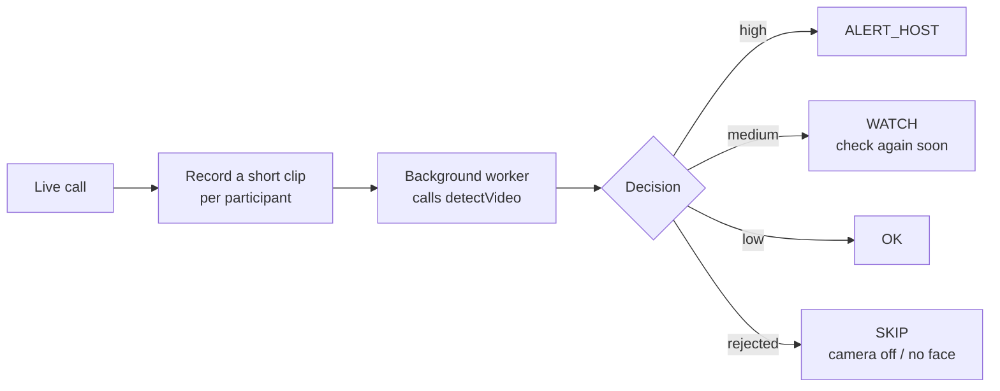

# Video conferencing: detect deepfake participants during calls

**Who this is for:** video meeting platforms, webinar tools, telehealth, online exams and
proctoring, and any product where people meet over video.

[← All use cases](README.md)

## The problem

Attackers have joined video calls as a deepfake of a CEO or colleague to trick staff into
transferring money or sharing secrets. A real-time face swap or cloned voice can look and
sound convincing to everyone in the meeting.

## Where NeuroVerify fits

NeuroVerify checks **recorded files**, not live streams. So during the call, your platform
records **short clips** of each participant, for example 20–30 seconds at a time, or when
the host clicks **Verify participant**. A background worker checks each clip and alerts the
host when something looks wrong.



## The decision

| What NeuroVerify returns | Decision | What your system does |
|---|---|---|
| Rejected (camera off, screen share, no face) | `SKIP` | Do nothing; this is normal in meetings |
| A status this SDK version doesn't recognize | `WATCH` | Check the next clip; upgrade the SDK |
| Video **or** audio risk is `high` | `ALERT_HOST` | Show the host a private warning |
| Video **or** audio risk is `medium` | `WATCH` | Check the next clip sooner |
| Both `low` | `OK` | Nothing to do |
| Bad input | `INVALID_INPUT` | Check your clip recorder |
| NeuroVerify temporarily unreachable | `SERVICE_UNAVAILABLE` | Try the next clip |

## The code

Every SDK below implements exactly the same logic for **one clip**. Call it from a background
worker or job queue, never on the thread that handles the live call. The outputs are
representative.

<details open>
<summary><b>Python</b></summary>

```python
"""Video conferencing: check a short clip of a meeting participant for deepfakes."""

import json
from datetime import datetime, timezone

from neuraldefend import NeuroVerifyClient, NeuroVerifyError, ValidationError

client = NeuroVerifyClient()  # reads NEURALDEFEND_API_KEY; create once and reuse


def save_audit(record):
    print("audit:", json.dumps(record))  # replace with a write to your database


def check_meeting_clip(meeting_id, participant_id, clip_path):
    try:
        result = client.detect_video(clip_path)
    except NeuroVerifyError as error:
        # ValidationError means bad input or config; anything else is auth, limits, or outages.
        failed = "INVALID_INPUT" if isinstance(error, ValidationError) else "SERVICE_UNAVAILABLE"
        return {
            "meeting_id": meeting_id,
            "participant_id": participant_id,
            "decision": failed,
            "reason": error.detail,
            "transaction_id": None,
        }

    save_audit(
        {
            "subject": participant_id,
            "transaction_id": result.unique_trx_id,
            "status": result.status,
            "video_risk_level": result.video_risk_level,
            "audio_risk_level": result.audio_risk_level,
            "billable": result.billable,
            "timestamp": datetime.now(timezone.utc).isoformat(),
        }
    )

    levels = (result.video_risk_level, result.audio_risk_level)
    if result.rejected:  # e.g. camera off or no face in the clip
        decision = "SKIP"
    elif not result.scored:  # a status this code does not know yet
        decision = "WATCH"
    elif "high" in levels:
        decision = "ALERT_HOST"
    elif "medium" in levels:
        decision = "WATCH"
    else:
        decision = "OK"

    return {
        "meeting_id": meeting_id,
        "participant_id": participant_id,
        "decision": decision,
        "reason": result.video_message,
        "transaction_id": result.unique_trx_id,
    }


if __name__ == "__main__":
    print(json.dumps(check_meeting_clip("mtg_5005", "user_42", "clip_0001.mp4"), indent=2))
```

Output:

```text
audit: {"subject": "user_42", "transaction_id": "trx_example_video_low", "status": "success", "video_risk_level": "low", "audio_risk_level": "low", "billable": true, "timestamp": "2026-10-16T09:41:07.512310+00:00"}
{
  "meeting_id": "mtg_5005",
  "participant_id": "user_42",
  "decision": "OK",
  "reason": "Not likely to be AI-generated",
  "transaction_id": "trx_example_video_low"
}
```

</details>

<details>
<summary><b>TypeScript (Node.js)</b></summary>

```ts
/**
 * Video conferencing: check a short clip of a meeting participant for deepfakes.
 *
 *   export NEURALDEFEND_API_KEY="replace-with-your-api-key"
 *   npx tsx video-conferencing.ts
 */
import {
  NeuroVerifyClient,
  NeuroVerifyError,
  ValidationError,
  type VideoResult,
} from "@neuraldefend/sdk";

// Create one client and reuse it. It reads NEURALDEFEND_API_KEY.
const client = new NeuroVerifyClient();

// Stand-in for your database: keep one audit row per API call.
function saveAudit(record: Record<string, unknown>): void {
  console.log("audit:", JSON.stringify(record));
}

async function checkMeetingClip(
  meetingId: string,
  participantId: string,
  clipPath: string,
) {
  let result: VideoResult;
  try {
    result = await client.detectVideo(clipPath);
  } catch (error) {
    if (error instanceof ValidationError) {
      return {
        meetingId,
        participantId,
        decision: "INVALID_INPUT",
        reason: error.detail,
        transactionId: null,
      };
    }
    if (error instanceof NeuroVerifyError) {
      return {
        meetingId,
        participantId,
        decision: "SERVICE_UNAVAILABLE",
        reason: error.detail,
        transactionId: null,
      };
    }
    throw error;
  }

  saveAudit({
    subject: participantId,
    transactionId: result.uniqueTrxId,
    status: result.status,
    videoRiskLevel: result.videoRiskLevel,
    audioRiskLevel: result.audioRiskLevel,
    billable: result.billable,
    timestamp: new Date().toISOString(),
  });

  let decision: string;
  if (result.status === "rejected") {
    decision = "SKIP"; // e.g. camera off or no face in the clip
  } else if (result.status !== "success") {
    decision = "WATCH"; // a newer status this code does not know yet
  } else if (
    result.videoRiskLevel === "high" ||
    result.audioRiskLevel === "high"
  ) {
    decision = "ALERT_HOST";
  } else if (
    result.videoRiskLevel === "medium" ||
    result.audioRiskLevel === "medium"
  ) {
    decision = "WATCH";
  } else {
    decision = "OK";
  }

  return {
    meetingId,
    participantId,
    decision,
    reason: result.videoMessage,
    transactionId: result.uniqueTrxId,
  };
}

const decision = await checkMeetingClip("mtg_5005", "user_42", "clip_0001.mp4");
console.log(JSON.stringify(decision, null, 2));
```

Output:

```text
audit: {"subject":"user_42","transactionId":"trx_example_video_low","status":"success","videoRiskLevel":"low","audioRiskLevel":"low","billable":true,"timestamp":"2026-10-16T09:41:07.512Z"}
{
  "meetingId": "mtg_5005",
  "participantId": "user_42",
  "decision": "OK",
  "reason": "Not likely to be AI-generated",
  "transactionId": "trx_example_video_low"
}
```

</details>

<details>
<summary><b>Go</b></summary>

```go
package main

import (
	"context"
	"encoding/json"
	"errors"
	"fmt"
	"log"
	"time"

	neuraldefend "github.com/Neural-Defend/NeuralDefend-SDKs/packages/go"
)

// One client for the whole program, created in main.
var client *neuraldefend.Client

type MeetingDecision struct {
	MeetingID     string  `json:"meeting_id"`
	ParticipantID string  `json:"participant_id"`
	Decision      string  `json:"decision"`
	Reason        string  `json:"reason"`
	TransactionID *string `json:"transaction_id"` // null when the API call failed
}

type AuditRecord struct {
	Subject        string  `json:"subject"`
	TransactionID  string  `json:"transaction_id"`
	Status         string  `json:"status"`
	VideoRiskLevel *string `json:"video_risk_level"`
	AudioRiskLevel *string `json:"audio_risk_level"`
	Billable       bool    `json:"billable"`
	Timestamp      string  `json:"timestamp"`
}

// saveAudit stands in for your database: it prints one line per API call.
func saveAudit(record AuditRecord) {
	line, _ := json.Marshal(record)
	fmt.Println("audit:", string(line))
}

// errorDecision maps an SDK error to a decision.
func errorDecision(err error) string {
	var validation *neuraldefend.ValidationError
	if errors.As(err, &validation) {
		return "INVALID_INPUT" // bad or missing input or configuration
	}
	return "SERVICE_UNAVAILABLE" // auth, scope, rate limit, server, timeout, network, protocol
}

// levelIs reports whether a risk level is present and equal to want.
func levelIs(level *string, want string) bool {
	return level != nil && *level == want
}

func checkMeetingClip(meetingID, participantID, clipPath string) MeetingDecision {
	out := MeetingDecision{MeetingID: meetingID, ParticipantID: participantID}

	result, err := client.DetectVideo(context.Background(), neuraldefend.FileMedia(clipPath), neuraldefend.VideoOptions{})
	if err != nil {
		out.Decision = errorDecision(err)
		out.Reason = err.Error()
		return out
	}

	saveAudit(AuditRecord{
		Subject:        participantID,
		TransactionID:  result.UniqueTrxID,
		Status:         result.Status,
		VideoRiskLevel: result.VideoRiskLevel,
		AudioRiskLevel: result.AudioRiskLevel,
		Billable:       result.Billable,
		Timestamp:      time.Now().UTC().Format(time.RFC3339),
	})
	out.Reason = result.VideoMessage
	out.TransactionID = &result.UniqueTrxID

	video, audio := result.VideoRiskLevel, result.AudioRiskLevel
	switch {
	case result.Rejected():
		out.Decision = "SKIP" // for example camera off or no face in view
	case !result.Scored():
		out.Decision = "WATCH" // a status this code does not know yet
	case levelIs(video, "high") || levelIs(audio, "high"):
		out.Decision = "ALERT_HOST"
	case levelIs(video, "medium") || levelIs(audio, "medium"):
		out.Decision = "WATCH"
	default:
		out.Decision = "OK"
	}
	return out
}

func main() {
	var err error
	client, err = neuraldefend.NewClient(neuraldefend.ClientOptions{}) // reads NEURALDEFEND_API_KEY
	if err != nil {
		log.Fatal(err)
	}

	decision := checkMeetingClip("mtg_5005", "user_42", "clip_0001.mp4")
	pretty, _ := json.MarshalIndent(decision, "", "  ")
	fmt.Println(string(pretty))
}
```

Output:

```text
audit: {"subject":"user_42","transaction_id":"trx_example_video_low","status":"success","video_risk_level":"low","audio_risk_level":"low","billable":true,"timestamp":"2026-10-16T09:41:07Z"}
{
  "meeting_id": "mtg_5005",
  "participant_id": "user_42",
  "decision": "OK",
  "reason": "Not likely to be AI-generated",
  "transaction_id": "trx_example_video_low"
}
```

</details>

<details>
<summary><b>Java</b></summary>

```java
import com.neuraldefend.AuthenticationException;
import com.neuraldefend.ClientOptions;
import com.neuraldefend.HttpException;
import com.neuraldefend.Media;
import com.neuraldefend.NetworkException;
import com.neuraldefend.NeuroVerifyClient;
import com.neuraldefend.ProtocolException;
import com.neuraldefend.RateLimitException;
import com.neuraldefend.ScopeException;
import com.neuraldefend.ServerException;
import com.neuraldefend.ValidationException;
import com.neuraldefend.VideoOptions;
import com.neuraldefend.VideoResult;
import java.time.Instant;
import java.time.temporal.ChronoUnit;

public class VideoConferencing {
    // One client for the whole app. It reads NEURALDEFEND_API_KEY from the environment.
    private static final NeuroVerifyClient CLIENT = NeuroVerifyClient.newClient(new ClientOptions());

    public record MeetingDecision(
            String meetingId, String participantId, String decision, String reason, String transactionId) {}

    public record AuditRecord(
            String subject, String transactionId, String status, String videoRiskLevel,
            String audioRiskLevel, boolean billable, Instant timestamp) {}

    // Stand-in for your database: one line per API call.
    static void saveAudit(AuditRecord record) {
        System.out.println("audit: " + record);
    }

    public static MeetingDecision checkMeetingClip(String meetingId, String participantId, String clipPath) {
        VideoResult result;
        try {
            result = CLIENT.detectVideo(Media.fileMedia(clipPath), new VideoOptions());
        } catch (ValidationException error) {
            return new MeetingDecision(meetingId, participantId, "INVALID_INPUT", error.getDetail(), null);
        } catch (AuthenticationException | ScopeException | RateLimitException | ServerException
                | com.neuraldefend.TimeoutException | NetworkException | ProtocolException
                | HttpException error) {
            // Every SDK error passes its detail to RuntimeException, so getMessage() returns it.
            return new MeetingDecision(
                    meetingId, participantId, "SERVICE_UNAVAILABLE", error.getMessage(), null);
        }

        saveAudit(new AuditRecord(participantId, result.uniqueTrxId, result.status, result.videoRiskLevel,
                result.audioRiskLevel, result.billable, Instant.now().truncatedTo(ChronoUnit.SECONDS)));

        String decision;
        if (result.rejected()) {
            decision = "SKIP"; // e.g. camera off or no face in this clip
        } else if (!result.scored()) {
            decision = "WATCH"; // unknown status: keep checking later clips
        } else if ("high".equals(result.videoRiskLevel) || "high".equals(result.audioRiskLevel)) {
            decision = "ALERT_HOST";
        } else if ("medium".equals(result.videoRiskLevel) || "medium".equals(result.audioRiskLevel)) {
            decision = "WATCH";
        } else {
            decision = "OK";
        }
        return new MeetingDecision(meetingId, participantId, decision, result.videoMessage, result.uniqueTrxId);
    }

    public static void main(String[] args) {
        System.out.println(checkMeetingClip("mtg_5005", "user_42", "clip_0001.mp4"));
    }
}
```

Output:

```text
audit: AuditRecord[subject=user_42, transactionId=trx_example_video_low, status=success, videoRiskLevel=low, audioRiskLevel=low, billable=true, timestamp=2026-10-16T09:41:07Z]
MeetingDecision[meetingId=mtg_5005, participantId=user_42, decision=OK, reason=Not likely to be AI-generated, transactionId=trx_example_video_low]
```

</details>

<details>
<summary><b>Kotlin</b></summary>

```kotlin
import com.neuraldefend.kotlin.MediaInput
import com.neuraldefend.kotlin.NeuroVerifyClient
import com.neuraldefend.kotlin.NeuroVerifyError
import com.neuraldefend.kotlin.ResultStatus
import com.neuraldefend.kotlin.RiskLevel
import com.neuraldefend.kotlin.ValidationError
import java.io.File
import java.time.Instant

data class MeetingDecision(
    val meetingId: String,
    val participantId: String,
    val decision: String,
    val reason: String,
    val transactionId: String? = null,
)

// Stand-in for your database: store one row per API call.
fun saveAudit(record: Map<String, Any?>) = println("audit: $record")

suspend fun checkMeetingClip(
    client: NeuroVerifyClient,
    meetingId: String,
    participantId: String,
    clipPath: String,
): MeetingDecision {
    val result = try {
        client.detectVideo(MediaInput.file(File(clipPath)))
    } catch (error: ValidationError) {
        return MeetingDecision(meetingId, participantId, "INVALID_INPUT", error.detail)
    } catch (error: NeuroVerifyError) {
        return MeetingDecision(meetingId, participantId, "SERVICE_UNAVAILABLE", error.detail)
    }

    saveAudit(
        mapOf(
            "subject" to participantId,
            "transactionId" to result.uniqueTrxId,
            "status" to result.status.wireValue,
            "videoRiskLevel" to result.videoRiskLevel?.wireValue,
            "audioRiskLevel" to result.audioRiskLevel?.wireValue,
            "billable" to result.billable,
            "timestamp" to Instant.now().toString(),
        ),
    )

    val video = result.videoRiskLevel
    val audio = result.audioRiskLevel
    val decision = when {
        result.status == ResultStatus.REJECTED -> "SKIP" // e.g. camera off or no face in the clip
        result.status != ResultStatus.SUCCESS -> "WATCH"
        video == RiskLevel.HIGH || audio == RiskLevel.HIGH -> "ALERT_HOST"
        video == RiskLevel.MEDIUM || audio == RiskLevel.MEDIUM -> "WATCH"
        else -> "OK"
    }
    return MeetingDecision(meetingId, participantId, decision, result.videoMessage, result.uniqueTrxId)
}

suspend fun main() {
    NeuroVerifyClient().use { client -> // reads NEURALDEFEND_API_KEY
        val decision = checkMeetingClip(client, "mtg_5005", "user_42", "clip_0001.mp4")
        println(decision)
    }
}
```

Output:

```text
audit: {subject=user_42, transactionId=trx_example_video_low, status=success, videoRiskLevel=low, audioRiskLevel=low, billable=true, timestamp=2026-10-16T09:41:07.512310Z}
MeetingDecision(meetingId=mtg_5005, participantId=user_42, decision=OK, reason=Not likely to be AI-generated, transactionId=trx_example_video_low)
```

</details>

<details>
<summary><b>Dart</b></summary>

```dart
import 'dart:convert';

import 'package:neuraldefend/neuraldefend.dart';

/// Checks a short clip of one meeting participant for deepfake signs.
Future<Map<String, Object?>> checkMeetingClip(
  NeuroVerifyClient client,
  String meetingId,
  String participantId,
  String clipPath,
) async {
  try {
    final result = await client.detectVideo(MediaInput.file(clipPath));
    saveAudit({
      'subject': participantId,
      'transactionId': result.uniqueTrxId,
      'status': result.status.name,
      'videoRiskLevel': result.videoRiskLevel?.name,
      'audioRiskLevel': result.audioRiskLevel?.name,
      'billable': result.billable,
      'timestamp': DateTime.now().toUtc().toIso8601String(),
    });

    // Check the status first, then the risk levels. Never compare raw scores.
    final levels = [result.videoRiskLevel, result.audioRiskLevel];
    final String decision;
    if (result.rejected) {
      decision = 'SKIP'; // for example camera off or no face in the clip
    } else if (!result.scored) {
      decision = 'WATCH'; // a status this SDK version does not know yet
    } else if (levels.contains(RiskLevel.high)) {
      decision = 'ALERT_HOST';
    } else if (levels.contains(RiskLevel.medium)) {
      decision = 'WATCH';
    } else {
      decision = 'OK';
    }
    return {
      'meetingId': meetingId,
      'participantId': participantId,
      'decision': decision,
      'reason': result.videoMessage,
      'transactionId': result.uniqueTrxId,
    };
  } on ValidationError catch (error) {
    // Bad input, such as a missing or empty file. Fix it; do not retry unchanged.
    return {
      'meetingId': meetingId,
      'participantId': participantId,
      'decision': 'INVALID_INPUT',
      'reason': error.detail,
      'transactionId': null,
    };
  } on NeuroVerifyError catch (error) {
    // Auth, rate limit, server, timeout, or network problem.
    return {
      'meetingId': meetingId,
      'participantId': participantId,
      'decision': 'SERVICE_UNAVAILABLE',
      'reason': error.detail,
      'transactionId': null,
    };
  }
}

/// Stand-in for your database: keep one row per transaction.
void saveAudit(Map<String, Object?> record) {
  print('audit: ${jsonEncode(record)}');
}

Future<void> main() async {
  // Reads NEURALDEFEND_API_KEY. Create one client and reuse it.
  final client = NeuroVerifyClient();
  try {
    final decision = await checkMeetingClip(
      client,
      'mtg_5005',
      'user_42',
      'clip_0001.mp4',
    );
    print(const JsonEncoder.withIndent('  ').convert(decision));
  } finally {
    client.close();
  }
}
```

Output:

```text
audit: {"subject":"user_42","transactionId":"trx_example_video_low","status":"success","videoRiskLevel":"low","audioRiskLevel":"low","billable":true,"timestamp":"2026-10-16T03:02:51.051363Z"}
{
  "meetingId": "mtg_5005",
  "participantId": "user_42",
  "decision": "OK",
  "reason": "Not likely to be AI-generated",
  "transactionId": "trx_example_video_low"
}
```

</details>

<details>
<summary><b>Swift</b></summary>

```swift
// main.swift
import Foundation
import NeuralDefend

/// The decision returned to the meeting monitor.
struct MeetingClipDecision: Encodable, Sendable {
    let meetingId: String
    let participantId: String
    let decision: String
    let reason: String
    let transactionId: String?  // nil on errors

    private enum CodingKeys: String, CodingKey {
        case meetingId, participantId, decision, reason, transactionId
    }

    // Written by hand so a nil transactionId becomes null instead of being left out.
    func encode(to encoder: any Encoder) throws {
        var container = encoder.container(keyedBy: CodingKeys.self)
        try container.encode(meetingId, forKey: .meetingId)
        try container.encode(participantId, forKey: .participantId)
        try container.encode(decision, forKey: .decision)
        try container.encode(reason, forKey: .reason)
        try container.encode(transactionId, forKey: .transactionId)
    }
}

/// One audit row. Stands in for your database table.
struct AuditRecord: Encodable, Sendable {
    let subject: String
    let transactionId: String
    let status: String
    let videoRiskLevel: String?
    let audioRiskLevel: String?
    let billable: Bool
    let timestamp: String

    private enum CodingKeys: String, CodingKey {
        case subject, transactionId, status, videoRiskLevel, audioRiskLevel, billable, timestamp
    }

    // Written by hand so nil risk levels become null instead of being left out.
    func encode(to encoder: any Encoder) throws {
        var container = encoder.container(keyedBy: CodingKeys.self)
        try container.encode(subject, forKey: .subject)
        try container.encode(transactionId, forKey: .transactionId)
        try container.encode(status, forKey: .status)
        try container.encode(videoRiskLevel, forKey: .videoRiskLevel)
        try container.encode(audioRiskLevel, forKey: .audioRiskLevel)
        try container.encode(billable, forKey: .billable)
        try container.encode(timestamp, forKey: .timestamp)
    }
}

func saveAudit(_ record: AuditRecord) {
    // Replace this print with an insert into your own database.
    let encoder = JSONEncoder()
    encoder.outputFormatting = [.sortedKeys, .withoutEscapingSlashes]
    if let json = try? encoder.encode(record) {
        print("audit: " + String(decoding: json, as: UTF8.self))
    }
}

func checkMeetingClip(
    client: NeuroVerifyClient,
    meetingId: String,
    participantId: String,
    clipPath: String
) async -> MeetingClipDecision {
    let result: VideoResult
    do {
        result = try await client.detectVideo(.file(URL(fileURLWithPath: clipPath)))
    } catch NeuroVerifyError.validation(_, let message) {
        // Bad or missing input or configuration.
        return MeetingClipDecision(
            meetingId: meetingId, participantId: participantId, decision: "INVALID_INPUT",
            reason: message, transactionId: nil)
    } catch {
        // Any other SDK error: authentication, scope, rate limit, server, timeout, network, protocol.
        let reason = (error as? NeuroVerifyError)?.message ?? String(describing: error)
        return MeetingClipDecision(
            meetingId: meetingId, participantId: participantId, decision: "SERVICE_UNAVAILABLE",
            reason: reason, transactionId: nil)
    }

    saveAudit(
        AuditRecord(
            subject: participantId,
            transactionId: result.uniqueTrxID,
            status: result.status.rawValue,
            videoRiskLevel: result.videoRiskLevel?.rawValue,
            audioRiskLevel: result.audioRiskLevel?.rawValue,
            billable: result.billable,
            timestamp: ISO8601DateFormatter().string(from: Date())
        ))

    // Status first, then the video and audio risk bands. Never compare numeric scores.
    let video = result.videoRiskLevel
    let audio = result.audioRiskLevel
    let decision: String
    if result.isRejected {
        decision = "SKIP"  // for example camera off or no face in the clip
    } else if !result.isScored {
        decision = "WATCH"  // a status this SDK version does not know
    } else if video == .high || audio == .high {
        decision = "ALERT_HOST"
    } else if video == .medium || audio == .medium {
        decision = "WATCH"
    } else {
        decision = "OK"
    }
    return MeetingClipDecision(
        meetingId: meetingId, participantId: participantId, decision: decision,
        reason: result.videoMessage, transactionId: result.uniqueTrxID)
}

let client = try NeuroVerifyClient.fromEnvironment()  // reads NEURALDEFEND_API_KEY
let outcome = await checkMeetingClip(
    client: client, meetingId: "mtg_5005", participantId: "user_42", clipPath: "clip_0001.mp4")

let encoder = JSONEncoder()
encoder.outputFormatting = [.prettyPrinted, .sortedKeys, .withoutEscapingSlashes]
print(String(decoding: try encoder.encode(outcome), as: UTF8.self))
```

Output:

```text
audit: {"audioRiskLevel":"low","billable":true,"status":"success","subject":"user_42","timestamp":"2026-10-16T09:41:07Z","transactionId":"trx_example_video_low","videoRiskLevel":"low"}
{
  "decision" : "OK",
  "meetingId" : "mtg_5005",
  "participantId" : "user_42",
  "reason" : "Not likely to be AI-generated",
  "transactionId" : "trx_example_video_low"
}
```

</details>

## Design tips

- **Don't check every second of every call.** Each clip is a billable transaction. Good
  triggers: when someone joins, every few minutes, when the host asks, or before a sensitive
  moment (for example, when someone asks for a payment).
- **Short clips are enough.** 20–30 seconds with a clear face and speech gives the video and
  audio checks something to work with, while keeping uploads small.
- **Limit concurrency.** Run a fixed number of checks in parallel per meeting server, and
  respect rate limits (the SDKs retry rate-limited requests for you).
- **Alert privately.** Show warnings only to the host or a moderator, never to everyone.
- **Tell participants.** Disclose in your terms and in the meeting UI that calls may be
  checked for manipulated media, and get consent where the law requires it.

## Production checklist

- [ ] Clips are recorded per participant (not the whole gallery view).
- [ ] Checks run in a background worker with a concurrency limit.
- [ ] `ALERT_HOST` reaches only the host or moderator.
- [ ] You store the `transaction_id` with the meeting and participant IDs.
- [ ] Clips are deleted after checking, unless your policy says otherwise.
- [ ] The API key lives only on your backend.

## Related

- [HR tech](hr-tech.md): checking recorded interviews.
- [Video KYC](video-kyc.md): checking recorded verification sessions.
- [Video response reference](../client/unified-video-authenticity.md)
