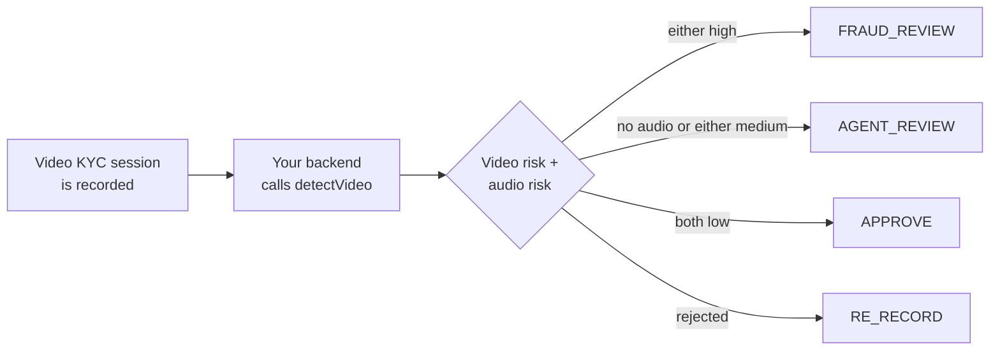

# Video KYC: verify recorded video sessions, face and voice

**Who this is for:** Video KYC (V-CIP) platforms, banks, insurers, and NBFCs that verify
customers over a recorded video call with an agent, or through a self-recorded video.

[← All use cases](README.md)

## The problem

Video KYC was meant to be harder to fake than a photo. Attackers now use **real-time face
swaps** and **voice cloning**: the face on camera belongs to the victim, and the voice
sounds like them too. An agent watching a live call often can't tell.

## Where NeuroVerify fits

After the session ends, send the **recording** to NeuroVerify. You get two separate
answers, one for the **video** (the face) and one for the **audio** (the voice), so a real
face with a cloned voice is still caught.



> [!NOTE]
> NeuroVerify analyzes **recorded files**, not a live stream. Check the recording as soon
> as the session ends, before the account is activated. For checks *during* a call, record
> short clips as shown in [Video conferencing](video-conferencing.md).

## The decision

The rules are applied **in this order**; the first one that matches wins:

| # | What NeuroVerify returns | Decision | What your system does |
|:-:|---|---|---|
| 1 | Rejected (for example, no face found in the recording) | `RE_RECORD` | Schedule a new session |
| 2 | A status this SDK version doesn't recognize | `AGENT_REVIEW` | A senior agent reviews the recording |
| 3 | Video **or** audio risk is `high` | `FRAUD_REVIEW` | Hold the account and send to your fraud team |
| 4 | The recording has **no audio track** | `AGENT_REVIEW` | Video KYC needs the voice; review the session manually |
| 5 | Video **or** audio risk is `medium` | `AGENT_REVIEW` | A senior agent reviews the recording |
| 6 | Both are `low` | `APPROVE` | Continue the KYC process |
| – | Bad input | `INVALID_INPUT` | Check the recording file |
| – | NeuroVerify temporarily unreachable | `SERVICE_UNAVAILABLE` | Retry later; keep the account on hold |

The code checks **24 frames** instead of the default 12, because KYC sessions are usually
longer and the decision matters more. Each check of a recording is one transaction.

## The code

Every SDK below implements exactly the same logic. It receives the **path** to the
recording, so the SDK streams large files instead of loading them into memory. The outputs
are representative: in this example the face looks real but the voice is likely cloned.

<details open>
<summary><b>Python</b></summary>

```python
"""Video KYC: review a recorded identity-verification session (face and voice)."""

import json
from datetime import datetime, timezone

from neuraldefend import NeuroVerifyClient, NeuroVerifyError, ValidationError

client = NeuroVerifyClient()  # reads NEURALDEFEND_API_KEY; create once and reuse


def save_audit(record):
    print("audit:", json.dumps(record))  # replace with a write to your database


def review_video_kyc_session(session_id, recording_path):
    try:
        # Pass the path so the SDK streams the file; 24 frames gives better coverage.
        result = client.detect_video(recording_path, max_frames=24)
    except NeuroVerifyError as error:
        # ValidationError means bad input or config; anything else is auth, limits, or outages.
        failed = "INVALID_INPUT" if isinstance(error, ValidationError) else "SERVICE_UNAVAILABLE"
        return {
            "session_id": session_id,
            "decision": failed,
            "reason": error.detail,
            "video_risk_level": None,
            "audio_risk_level": None,
            "transaction_id": None,
        }

    save_audit(
        {
            "subject": session_id,
            "transaction_id": result.unique_trx_id,
            "status": result.status,
            "video_risk_level": result.video_risk_level,
            "audio_risk_level": result.audio_risk_level,
            "billable": result.billable,
            "timestamp": datetime.now(timezone.utc).isoformat(),
        }
    )

    levels = (result.video_risk_level, result.audio_risk_level)
    reason = result.video_message
    if result.rejected:  # e.g. no face in the recording
        decision = "RE_RECORD"
    elif not result.scored:  # a status this code does not know yet
        decision = "AGENT_REVIEW"
    elif "high" in levels:
        decision = "FRAUD_REVIEW"
    elif not result.has_audio:
        decision = "AGENT_REVIEW"
        reason = "No audio track in the session recording"
    elif "medium" in levels:
        decision = "AGENT_REVIEW"
    else:
        decision = "APPROVE"

    return {
        "session_id": session_id,
        "decision": decision,
        "reason": reason,
        "video_risk_level": result.video_risk_level,
        "audio_risk_level": result.audio_risk_level,
        "transaction_id": result.unique_trx_id,
    }


if __name__ == "__main__":
    print(json.dumps(review_video_kyc_session("vkyc_3003", "session.mp4"), indent=2))
```

Output:

```text
audit: {"subject": "vkyc_3003", "transaction_id": "trx_example_video_modalities", "status": "success", "video_risk_level": "low", "audio_risk_level": "high", "billable": true, "timestamp": "2026-10-16T09:41:07.512310+00:00"}
{
  "session_id": "vkyc_3003",
  "decision": "FRAUD_REVIEW",
  "reason": "Not likely to be AI-generated",
  "video_risk_level": "low",
  "audio_risk_level": "high",
  "transaction_id": "trx_example_video_modalities"
}
```

</details>

<details>
<summary><b>TypeScript (Node.js)</b></summary>

```ts
/**
 * Video KYC: review a recorded video KYC session for face swaps and cloned voices.
 *
 *   export NEURALDEFEND_API_KEY="replace-with-your-api-key"
 *   npx tsx video-kyc.ts
 */
import {
  NeuroVerifyClient,
  NeuroVerifyError,
  ValidationError,
  type VideoResult,
} from "@neuraldefend/sdk";

// Create one client and reuse it. It reads NEURALDEFEND_API_KEY.
const client = new NeuroVerifyClient();

// Stand-in for your database: keep one audit row per API call.
function saveAudit(record: Record<string, unknown>): void {
  console.log("audit:", JSON.stringify(record));
}

async function reviewVideoKycSession(sessionId: string, recordingPath: string) {
  let result: VideoResult;
  try {
    // Pass the path so the SDK streams the recording instead of loading it.
    result = await client.detectVideo(recordingPath, { maxFrames: 24 });
  } catch (error) {
    if (error instanceof ValidationError) {
      return {
        sessionId,
        decision: "INVALID_INPUT",
        reason: error.detail,
        videoRiskLevel: null,
        audioRiskLevel: null,
        transactionId: null,
      };
    }
    if (error instanceof NeuroVerifyError) {
      return {
        sessionId,
        decision: "SERVICE_UNAVAILABLE",
        reason: error.detail,
        videoRiskLevel: null,
        audioRiskLevel: null,
        transactionId: null,
      };
    }
    throw error;
  }

  saveAudit({
    subject: sessionId,
    transactionId: result.uniqueTrxId,
    status: result.status,
    videoRiskLevel: result.videoRiskLevel,
    audioRiskLevel: result.audioRiskLevel,
    billable: result.billable,
    timestamp: new Date().toISOString(),
  });

  let decision: string;
  let reason = result.videoMessage;
  if (result.status === "rejected") {
    decision = "RE_RECORD"; // e.g. no face in the recording
  } else if (result.status !== "success") {
    decision = "AGENT_REVIEW"; // a newer status this code does not know yet
  } else if (
    result.videoRiskLevel === "high" ||
    result.audioRiskLevel === "high"
  ) {
    decision = "FRAUD_REVIEW";
  } else if (!result.hasAudio) {
    decision = "AGENT_REVIEW";
    reason = "No audio track in the session recording";
  } else if (
    result.videoRiskLevel === "medium" ||
    result.audioRiskLevel === "medium"
  ) {
    decision = "AGENT_REVIEW";
  } else {
    decision = "APPROVE";
  }

  return {
    sessionId,
    decision,
    reason,
    videoRiskLevel: result.videoRiskLevel,
    audioRiskLevel: result.audioRiskLevel,
    transactionId: result.uniqueTrxId,
  };
}

const decision = await reviewVideoKycSession("vkyc_3003", "session.mp4");
console.log(JSON.stringify(decision, null, 2));
```

Output:

```text
audit: {"subject":"vkyc_3003","transactionId":"trx_example_video_modalities","status":"success","videoRiskLevel":"low","audioRiskLevel":"high","billable":true,"timestamp":"2026-10-16T09:41:07.512Z"}
{
  "sessionId": "vkyc_3003",
  "decision": "FRAUD_REVIEW",
  "reason": "Not likely to be AI-generated",
  "videoRiskLevel": "low",
  "audioRiskLevel": "high",
  "transactionId": "trx_example_video_modalities"
}
```

</details>

<details>
<summary><b>Go</b></summary>

```go
package main

import (
	"context"
	"encoding/json"
	"errors"
	"fmt"
	"log"
	"time"

	neuraldefend "github.com/Neural-Defend/NeuralDefend-SDKs/packages/go"
)

// One client for the whole program, created in main.
var client *neuraldefend.Client

type VideoKYCDecision struct {
	SessionID      string  `json:"session_id"`
	Decision       string  `json:"decision"`
	Reason         string  `json:"reason"`
	VideoRiskLevel *string `json:"video_risk_level"` // null when not scored
	AudioRiskLevel *string `json:"audio_risk_level"` // null when not scored or no audio
	TransactionID  *string `json:"transaction_id"`   // null when the API call failed
}

type AuditRecord struct {
	Subject        string  `json:"subject"`
	TransactionID  string  `json:"transaction_id"`
	Status         string  `json:"status"`
	VideoRiskLevel *string `json:"video_risk_level"`
	AudioRiskLevel *string `json:"audio_risk_level"`
	Billable       bool    `json:"billable"`
	Timestamp      string  `json:"timestamp"`
}

// saveAudit stands in for your database: it prints one line per API call.
func saveAudit(record AuditRecord) {
	line, _ := json.Marshal(record)
	fmt.Println("audit:", string(line))
}

// errorDecision maps an SDK error to a decision.
func errorDecision(err error) string {
	var validation *neuraldefend.ValidationError
	if errors.As(err, &validation) {
		return "INVALID_INPUT" // bad or missing input or configuration
	}
	return "SERVICE_UNAVAILABLE" // auth, scope, rate limit, server, timeout, network, protocol
}

// levelIs reports whether a risk level is present and equal to want.
func levelIs(level *string, want string) bool {
	return level != nil && *level == want
}

func reviewVideoKYCSession(sessionID, recordingPath string) VideoKYCDecision {
	out := VideoKYCDecision{SessionID: sessionID}

	maxFrames := 24
	result, err := client.DetectVideo(
		context.Background(),
		neuraldefend.FileMedia(recordingPath), // streamed from disk, not loaded into memory
		neuraldefend.VideoOptions{MaxFrames: &maxFrames},
	)
	if err != nil {
		out.Decision = errorDecision(err)
		out.Reason = err.Error()
		return out
	}

	saveAudit(AuditRecord{
		Subject:        sessionID,
		TransactionID:  result.UniqueTrxID,
		Status:         result.Status,
		VideoRiskLevel: result.VideoRiskLevel,
		AudioRiskLevel: result.AudioRiskLevel,
		Billable:       result.Billable,
		Timestamp:      time.Now().UTC().Format(time.RFC3339),
	})
	out.Reason = result.VideoMessage
	out.VideoRiskLevel = result.VideoRiskLevel
	out.AudioRiskLevel = result.AudioRiskLevel
	out.TransactionID = &result.UniqueTrxID

	video, audio := result.VideoRiskLevel, result.AudioRiskLevel
	switch {
	case result.Rejected():
		out.Decision = "RE_RECORD"
	case !result.Scored():
		out.Decision = "AGENT_REVIEW" // a status this code does not know yet
	case levelIs(video, "high") || levelIs(audio, "high"):
		out.Decision = "FRAUD_REVIEW"
	case !result.HasAudio():
		out.Decision = "AGENT_REVIEW"
		out.Reason = "No audio track in the session recording"
	case levelIs(video, "medium") || levelIs(audio, "medium"):
		out.Decision = "AGENT_REVIEW"
	default:
		out.Decision = "APPROVE"
	}
	return out
}

func main() {
	var err error
	client, err = neuraldefend.NewClient(neuraldefend.ClientOptions{}) // reads NEURALDEFEND_API_KEY
	if err != nil {
		log.Fatal(err)
	}

	decision := reviewVideoKYCSession("vkyc_3003", "session.mp4")
	pretty, _ := json.MarshalIndent(decision, "", "  ")
	fmt.Println(string(pretty))
}
```

Output:

```text
audit: {"subject":"vkyc_3003","transaction_id":"trx_example_video_modalities","status":"success","video_risk_level":"low","audio_risk_level":"high","billable":true,"timestamp":"2026-10-16T09:41:07Z"}
{
  "session_id": "vkyc_3003",
  "decision": "FRAUD_REVIEW",
  "reason": "Not likely to be AI-generated",
  "video_risk_level": "low",
  "audio_risk_level": "high",
  "transaction_id": "trx_example_video_modalities"
}
```

</details>

<details>
<summary><b>Java</b></summary>

```java
import com.neuraldefend.AuthenticationException;
import com.neuraldefend.ClientOptions;
import com.neuraldefend.HttpException;
import com.neuraldefend.Media;
import com.neuraldefend.NetworkException;
import com.neuraldefend.NeuroVerifyClient;
import com.neuraldefend.ProtocolException;
import com.neuraldefend.RateLimitException;
import com.neuraldefend.ScopeException;
import com.neuraldefend.ServerException;
import com.neuraldefend.ValidationException;
import com.neuraldefend.VideoOptions;
import com.neuraldefend.VideoResult;
import java.time.Instant;
import java.time.temporal.ChronoUnit;

public class VideoKyc {
    // One client for the whole app. It reads NEURALDEFEND_API_KEY from the environment.
    private static final NeuroVerifyClient CLIENT = NeuroVerifyClient.newClient(new ClientOptions());

    public record VideoKycDecision(
            String sessionId, String decision, String reason,
            String videoRiskLevel, String audioRiskLevel, String transactionId) {}

    public record AuditRecord(
            String subject, String transactionId, String status, String videoRiskLevel,
            String audioRiskLevel, boolean billable, Instant timestamp) {}

    // Stand-in for your database: one line per API call.
    static void saveAudit(AuditRecord record) {
        System.out.println("audit: " + record);
    }

    public static VideoKycDecision reviewVideoKycSession(String sessionId, String recordingPath) {
        VideoOptions options = new VideoOptions();
        options.maxFrames = 24; // sample more frames than the default for a KYC session
        VideoResult result;
        try {
            // fileMedia streams the recording from disk instead of loading it into memory.
            result = CLIENT.detectVideo(Media.fileMedia(recordingPath), options);
        } catch (ValidationException error) {
            return new VideoKycDecision(sessionId, "INVALID_INPUT", error.getDetail(), null, null, null);
        } catch (AuthenticationException | ScopeException | RateLimitException | ServerException
                | com.neuraldefend.TimeoutException | NetworkException | ProtocolException
                | HttpException error) {
            // Every SDK error passes its detail to RuntimeException, so getMessage() returns it.
            return new VideoKycDecision(
                    sessionId, "SERVICE_UNAVAILABLE", error.getMessage(), null, null, null);
        }

        saveAudit(new AuditRecord(sessionId, result.uniqueTrxId, result.status, result.videoRiskLevel,
                result.audioRiskLevel, result.billable, Instant.now().truncatedTo(ChronoUnit.SECONDS)));

        String decision;
        String reason = result.videoMessage;
        if (result.rejected()) {
            decision = "RE_RECORD"; // e.g. no face in the recording
        } else if (!result.scored()) {
            decision = "AGENT_REVIEW"; // unknown status: let an agent look
        } else if ("high".equals(result.videoRiskLevel) || "high".equals(result.audioRiskLevel)) {
            decision = "FRAUD_REVIEW";
        } else if (!result.hasAudio()) {
            decision = "AGENT_REVIEW";
            reason = "No audio track in the session recording";
        } else if ("medium".equals(result.videoRiskLevel) || "medium".equals(result.audioRiskLevel)) {
            decision = "AGENT_REVIEW";
        } else {
            decision = "APPROVE";
        }
        return new VideoKycDecision(sessionId, decision, reason,
                result.videoRiskLevel, result.audioRiskLevel, result.uniqueTrxId);
    }

    public static void main(String[] args) {
        System.out.println(reviewVideoKycSession("vkyc_3003", "session.mp4"));
    }
}
```

Output:

```text
audit: AuditRecord[subject=vkyc_3003, transactionId=trx_example_video_modalities, status=success, videoRiskLevel=low, audioRiskLevel=high, billable=true, timestamp=2026-10-16T09:41:07Z]
VideoKycDecision[sessionId=vkyc_3003, decision=FRAUD_REVIEW, reason=Not likely to be AI-generated, videoRiskLevel=low, audioRiskLevel=high, transactionId=trx_example_video_modalities]
```

</details>

<details>
<summary><b>Kotlin</b></summary>

```kotlin
import com.neuraldefend.kotlin.MediaInput
import com.neuraldefend.kotlin.NeuroVerifyClient
import com.neuraldefend.kotlin.NeuroVerifyError
import com.neuraldefend.kotlin.ResultStatus
import com.neuraldefend.kotlin.RiskLevel
import com.neuraldefend.kotlin.ValidationError
import java.io.File
import java.time.Instant

data class VideoKycDecision(
    val sessionId: String,
    val decision: String,
    val reason: String,
    val videoRiskLevel: String? = null,
    val audioRiskLevel: String? = null,
    val transactionId: String? = null,
)

// Stand-in for your database: store one row per API call.
fun saveAudit(record: Map<String, Any?>) = println("audit: $record")

suspend fun reviewVideoKycSession(
    client: NeuroVerifyClient,
    sessionId: String,
    recordingPath: String,
): VideoKycDecision {
    val result = try {
        // MediaInput.file streams the recording from disk instead of loading it into memory.
        client.detectVideo(MediaInput.file(File(recordingPath)), maxFrames = 24)
    } catch (error: ValidationError) {
        return VideoKycDecision(sessionId, "INVALID_INPUT", error.detail)
    } catch (error: NeuroVerifyError) {
        return VideoKycDecision(sessionId, "SERVICE_UNAVAILABLE", error.detail)
    }

    saveAudit(
        mapOf(
            "subject" to sessionId,
            "transactionId" to result.uniqueTrxId,
            "status" to result.status.wireValue,
            "videoRiskLevel" to result.videoRiskLevel?.wireValue,
            "audioRiskLevel" to result.audioRiskLevel?.wireValue,
            "billable" to result.billable,
            "timestamp" to Instant.now().toString(),
        ),
    )

    val video = result.videoRiskLevel
    val audio = result.audioRiskLevel
    // The order of these checks matters.
    val (decision, reason) = when {
        result.status == ResultStatus.REJECTED -> "RE_RECORD" to result.videoMessage
        result.status != ResultStatus.SUCCESS -> "AGENT_REVIEW" to result.videoMessage
        video == RiskLevel.HIGH || audio == RiskLevel.HIGH -> "FRAUD_REVIEW" to result.videoMessage
        !result.hasAudio -> "AGENT_REVIEW" to "No audio track in the session recording"
        video == RiskLevel.MEDIUM || audio == RiskLevel.MEDIUM -> "AGENT_REVIEW" to result.videoMessage
        else -> "APPROVE" to result.videoMessage
    }
    return VideoKycDecision(sessionId, decision, reason, video?.wireValue, audio?.wireValue, result.uniqueTrxId)
}

suspend fun main() {
    NeuroVerifyClient().use { client -> // reads NEURALDEFEND_API_KEY
        val decision = reviewVideoKycSession(client, "vkyc_3003", "session.mp4")
        println(decision)
    }
}
```

Output:

```text
audit: {subject=vkyc_3003, transactionId=trx_example_video_modalities, status=success, videoRiskLevel=low, audioRiskLevel=high, billable=true, timestamp=2026-10-16T09:41:07.512310Z}
VideoKycDecision(sessionId=vkyc_3003, decision=FRAUD_REVIEW, reason=Not likely to be AI-generated, videoRiskLevel=low, audioRiskLevel=high, transactionId=trx_example_video_modalities)
```

</details>

<details>
<summary><b>Dart</b></summary>

```dart
import 'dart:convert';

import 'package:neuraldefend/neuraldefend.dart';

/// Reviews a recorded video-KYC session. Video and audio are scored separately.
Future<Map<String, Object?>> reviewVideoKycSession(
  NeuroVerifyClient client,
  String sessionId,
  String recordingPath,
) async {
  try {
    // The SDK streams the file from disk, so large recordings are fine.
    final result = await client.detectVideo(
      MediaInput.file(recordingPath),
      maxFrames: 24,
    );
    saveAudit({
      'subject': sessionId,
      'transactionId': result.uniqueTrxId,
      'status': result.status.name,
      'videoRiskLevel': result.videoRiskLevel?.name,
      'audioRiskLevel': result.audioRiskLevel?.name,
      'billable': result.billable,
      'timestamp': DateTime.now().toUtc().toIso8601String(),
    });

    // Check the status first, then the risk levels. Never compare raw scores.
    final levels = [result.videoRiskLevel, result.audioRiskLevel];
    final String decision;
    var reason = result.videoMessage;
    if (result.rejected) {
      decision = 'RE_RECORD';
    } else if (!result.scored) {
      decision = 'AGENT_REVIEW'; // a status this SDK version does not know yet
    } else if (levels.contains(RiskLevel.high)) {
      decision = 'FRAUD_REVIEW';
    } else if (!result.hasAudio) {
      decision = 'AGENT_REVIEW';
      reason = 'No audio track in the session recording';
    } else if (levels.contains(RiskLevel.medium)) {
      decision = 'AGENT_REVIEW';
    } else {
      decision = 'APPROVE';
    }
    return {
      'sessionId': sessionId,
      'decision': decision,
      'reason': reason,
      'videoRiskLevel': result.videoRiskLevel?.name,
      'audioRiskLevel': result.audioRiskLevel?.name,
      'transactionId': result.uniqueTrxId,
    };
  } on ValidationError catch (error) {
    // Bad input, such as a missing or empty file. Fix it; do not retry unchanged.
    return {
      'sessionId': sessionId,
      'decision': 'INVALID_INPUT',
      'reason': error.detail,
      'videoRiskLevel': null,
      'audioRiskLevel': null,
      'transactionId': null,
    };
  } on NeuroVerifyError catch (error) {
    // Auth, rate limit, server, timeout, or network problem.
    return {
      'sessionId': sessionId,
      'decision': 'SERVICE_UNAVAILABLE',
      'reason': error.detail,
      'videoRiskLevel': null,
      'audioRiskLevel': null,
      'transactionId': null,
    };
  }
}

/// Stand-in for your database: keep one row per transaction.
void saveAudit(Map<String, Object?> record) {
  print('audit: ${jsonEncode(record)}');
}

Future<void> main() async {
  // Reads NEURALDEFEND_API_KEY. Create one client and reuse it.
  final client = NeuroVerifyClient();
  try {
    final decision = await reviewVideoKycSession(
      client,
      'vkyc_3003',
      'session.mp4',
    );
    print(const JsonEncoder.withIndent('  ').convert(decision));
  } finally {
    client.close();
  }
}
```

Output:

```text
audit: {"subject":"vkyc_3003","transactionId":"trx_example_video_modalities","status":"success","videoRiskLevel":"low","audioRiskLevel":"high","billable":true,"timestamp":"2026-10-16T03:02:51.046065Z"}
{
  "sessionId": "vkyc_3003",
  "decision": "FRAUD_REVIEW",
  "reason": "Not likely to be AI-generated",
  "videoRiskLevel": "low",
  "audioRiskLevel": "high",
  "transactionId": "trx_example_video_modalities"
}
```

</details>

<details>
<summary><b>Swift</b></summary>

```swift
// main.swift
import Foundation
import NeuralDefend

/// The decision returned to the video KYC review queue.
struct VideoKYCDecision: Encodable, Sendable {
    let sessionId: String
    let decision: String
    let reason: String
    let videoRiskLevel: String?  // nil on errors or when not scored
    let audioRiskLevel: String?  // also nil when the recording has no audio track
    let transactionId: String?  // nil on errors

    private enum CodingKeys: String, CodingKey {
        case sessionId, decision, reason, videoRiskLevel, audioRiskLevel, transactionId
    }

    // Written by hand so nil values become null instead of being left out.
    func encode(to encoder: any Encoder) throws {
        var container = encoder.container(keyedBy: CodingKeys.self)
        try container.encode(sessionId, forKey: .sessionId)
        try container.encode(decision, forKey: .decision)
        try container.encode(reason, forKey: .reason)
        try container.encode(videoRiskLevel, forKey: .videoRiskLevel)
        try container.encode(audioRiskLevel, forKey: .audioRiskLevel)
        try container.encode(transactionId, forKey: .transactionId)
    }
}

/// One audit row. Stands in for your database table.
struct AuditRecord: Encodable, Sendable {
    let subject: String
    let transactionId: String
    let status: String
    let videoRiskLevel: String?
    let audioRiskLevel: String?
    let billable: Bool
    let timestamp: String

    private enum CodingKeys: String, CodingKey {
        case subject, transactionId, status, videoRiskLevel, audioRiskLevel, billable, timestamp
    }

    // Written by hand so nil risk levels become null instead of being left out.
    func encode(to encoder: any Encoder) throws {
        var container = encoder.container(keyedBy: CodingKeys.self)
        try container.encode(subject, forKey: .subject)
        try container.encode(transactionId, forKey: .transactionId)
        try container.encode(status, forKey: .status)
        try container.encode(videoRiskLevel, forKey: .videoRiskLevel)
        try container.encode(audioRiskLevel, forKey: .audioRiskLevel)
        try container.encode(billable, forKey: .billable)
        try container.encode(timestamp, forKey: .timestamp)
    }
}

func saveAudit(_ record: AuditRecord) {
    // Replace this print with an insert into your own database.
    let encoder = JSONEncoder()
    encoder.outputFormatting = [.sortedKeys, .withoutEscapingSlashes]
    if let json = try? encoder.encode(record) {
        print("audit: " + String(decoding: json, as: UTF8.self))
    }
}

func reviewVideoKYCSession(
    client: NeuroVerifyClient,
    sessionId: String,
    recordingPath: String
) async -> VideoKYCDecision {
    let result: VideoResult
    do {
        // A file input is streamed from disk, so large recordings are never loaded into memory.
        result = try await client.detectVideo(
            .file(URL(fileURLWithPath: recordingPath)), maxFrames: 24)
    } catch NeuroVerifyError.validation(_, let message) {
        // Bad or missing input or configuration.
        return VideoKYCDecision(
            sessionId: sessionId, decision: "INVALID_INPUT", reason: message,
            videoRiskLevel: nil, audioRiskLevel: nil, transactionId: nil)
    } catch {
        // Any other SDK error: authentication, scope, rate limit, server, timeout, network, protocol.
        let reason = (error as? NeuroVerifyError)?.message ?? String(describing: error)
        return VideoKYCDecision(
            sessionId: sessionId, decision: "SERVICE_UNAVAILABLE", reason: reason,
            videoRiskLevel: nil, audioRiskLevel: nil, transactionId: nil)
    }

    saveAudit(
        AuditRecord(
            subject: sessionId,
            transactionId: result.uniqueTrxID,
            status: result.status.rawValue,
            videoRiskLevel: result.videoRiskLevel?.rawValue,
            audioRiskLevel: result.audioRiskLevel?.rawValue,
            billable: result.billable,
            timestamp: ISO8601DateFormatter().string(from: Date())
        ))

    // Video and audio are scored separately. Check them in this exact order.
    let video = result.videoRiskLevel
    let audio = result.audioRiskLevel
    var reason = result.videoMessage
    let decision: String
    if result.isRejected {
        decision = "RE_RECORD"  // for example no face in the recording
    } else if !result.isScored {
        decision = "AGENT_REVIEW"  // a status this SDK version does not know
    } else if video == .high || audio == .high {
        decision = "FRAUD_REVIEW"
    } else if !result.hasAudio {
        decision = "AGENT_REVIEW"
        reason = "No audio track in the session recording"
    } else if video == .medium || audio == .medium {
        decision = "AGENT_REVIEW"
    } else {
        decision = "APPROVE"
    }
    return VideoKYCDecision(
        sessionId: sessionId, decision: decision, reason: reason,
        videoRiskLevel: video?.rawValue, audioRiskLevel: audio?.rawValue,
        transactionId: result.uniqueTrxID)
}

let client = try NeuroVerifyClient.fromEnvironment()  // reads NEURALDEFEND_API_KEY
let outcome = await reviewVideoKYCSession(
    client: client, sessionId: "vkyc_3003", recordingPath: "session.mp4")

let encoder = JSONEncoder()
encoder.outputFormatting = [.prettyPrinted, .sortedKeys, .withoutEscapingSlashes]
print(String(decoding: try encoder.encode(outcome), as: UTF8.self))
```

Output:

```text
audit: {"audioRiskLevel":"high","billable":true,"status":"success","subject":"vkyc_3003","timestamp":"2026-10-16T09:41:07Z","transactionId":"trx_example_video_modalities","videoRiskLevel":"low"}
{
  "audioRiskLevel" : "high",
  "decision" : "FRAUD_REVIEW",
  "reason" : "Not likely to be AI-generated",
  "sessionId" : "vkyc_3003",
  "transactionId" : "trx_example_video_modalities",
  "videoRiskLevel" : "low"
}
```

</details>

## Production checklist

- [ ] The recording is checked **before** the account is activated.
- [ ] Your agents see both the video and the audio risk level, not just the decision.
- [ ] Recordings stay within the size limit (1,500,000,000 bytes) and use a supported
      format (MP4, MOV, WebM, and others; see the SDK guides).
- [ ] You store the `transaction_id` with the session ID for the regulator's audit trail.
- [ ] Recordings are processed under your consent, retention, and data-residency rules.
- [ ] The API key lives only on your backend.

## Related

- [eKYC onboarding](ekyc-onboarding.md): selfie checks at sign-up.
- [Video conferencing](video-conferencing.md): checks during a live call.
- [Video response reference](../client/unified-video-authenticity.md)
